# Paperplane

용도별 이메일 주소를 만들고, 조건에 맞는 메일을 원하는 메일함으로 전달하는 서비스입니다.

| 프로젝트 | 역할 |
| --- | --- |
| [web](apps/web/README.md) | React 웹 화면 |
| [api](apps/api/README.md) | 인증, 주소·전달 규칙·기록 관리 |
| [smtp](apps/smtp/README.md) | 수신 메일 분석과 전달 처리 |
| [postfix](apps/postfix/README.md) | 메일 송수신과 DKIM 서명 연결 |
| [database](apps/database/README.md) | PostgreSQL과 서비스별 DB 계정 |

## 서비스 구조

API가 주소와 전달 규칙을 관리하고, Mail Router가 수신 메일을 분석해 전달 대상을 조회합니다. Postfix는 실제 메일 수신과 발송을 담당합니다.

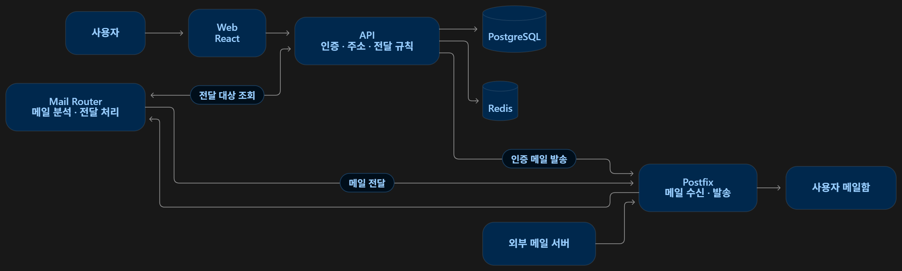

## 주요 화면

### 서비스 소개

용도별 주소 생성 → 받는 메일함 연결 → 전달 조건 설정 순서로 서비스를 시작합니다.

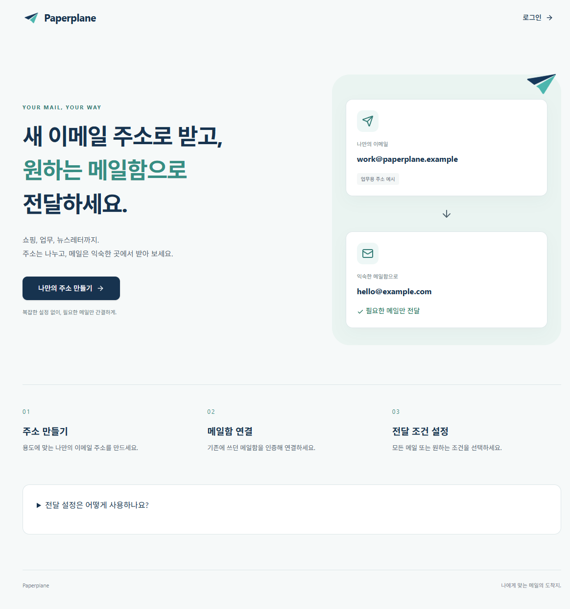

### 로그인과 회원가입

이메일·비밀번호 또는 Google·네이버 계정으로 로그인합니다. 이메일 가입은 인증 코드로 주소를 확인한 뒤 진행합니다.

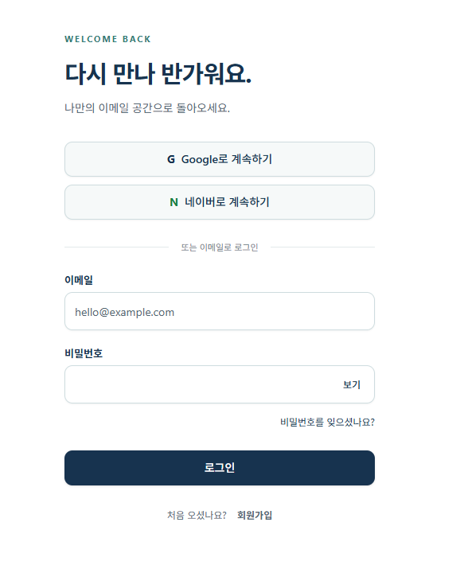

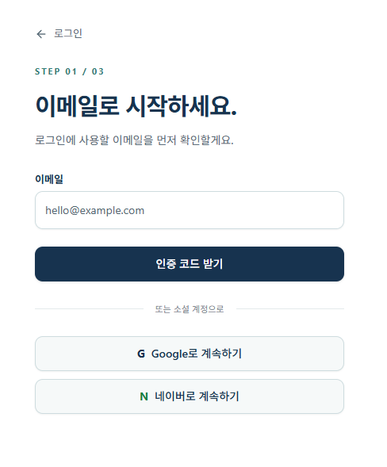

### 이메일 인증

가입이나 받는 메일함 연결 시 받은 인증 코드를 입력해 이메일 소유 여부를 확인합니다. 아래 이미지는 인증 메일의 화면 예시입니다.

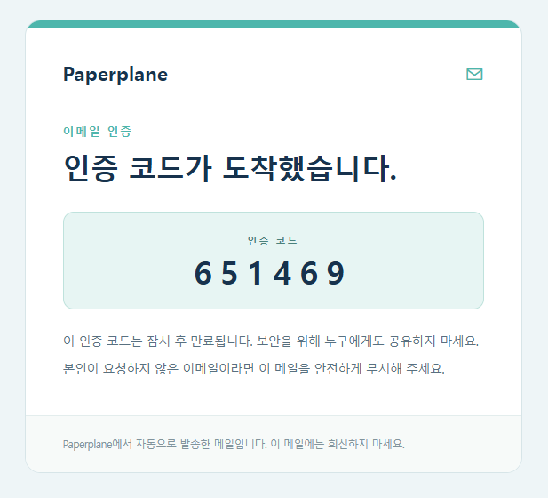

### 나만의 이메일 주소 만들기

내 이메일 화면에서 새 주소를 추가합니다. 주소 이름과 도메인을 선택하면 완성될 주소를 미리 확인할 수 있습니다.

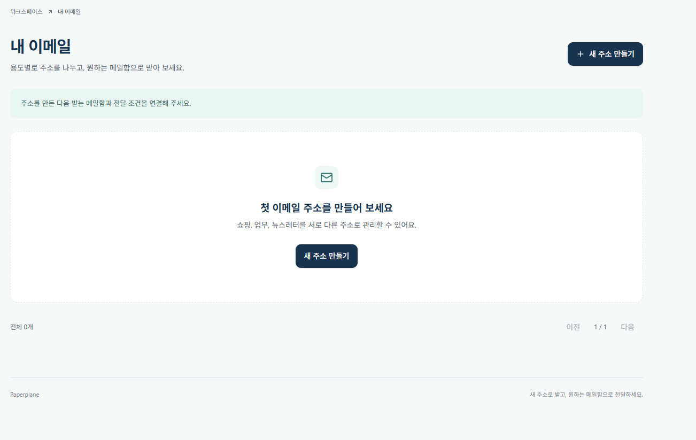

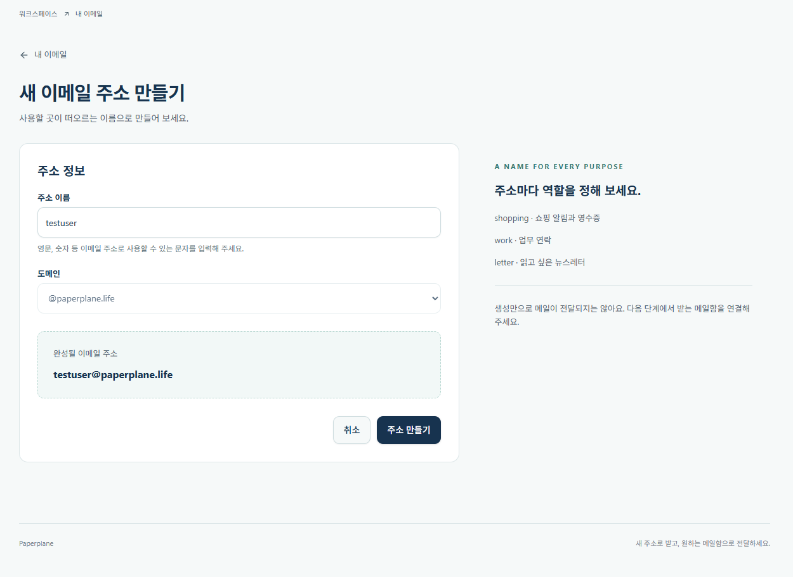

### 받는 메일함 연결

실제 메일을 받을 주소를 인증해 등록합니다. 인증된 메일함은 여러 Paperplane 주소의 전달 목적지로 사용할 수 있습니다.

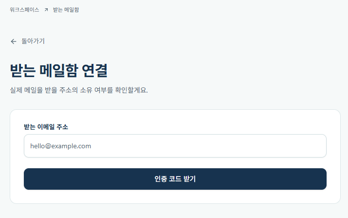

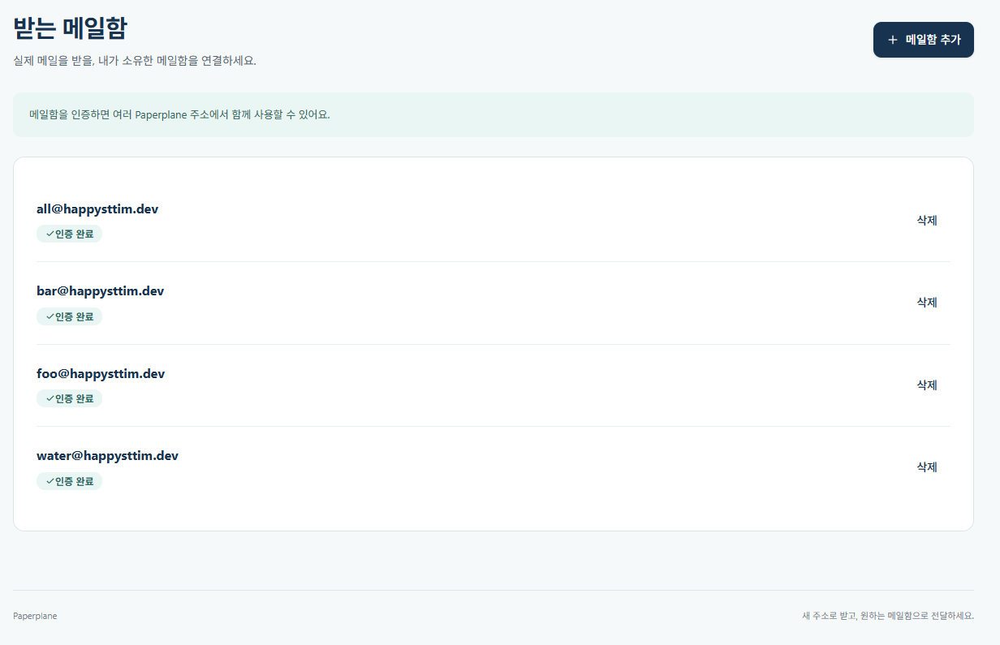

### 전달 규칙 설정

받는 메일함을 선택하고 모든 메일 또는 조건에 맞는 메일만 전달하도록 설정합니다. 샘플 메일 테스트로 실제 발송 없이 조건의 일치 여부를 확인합니다.

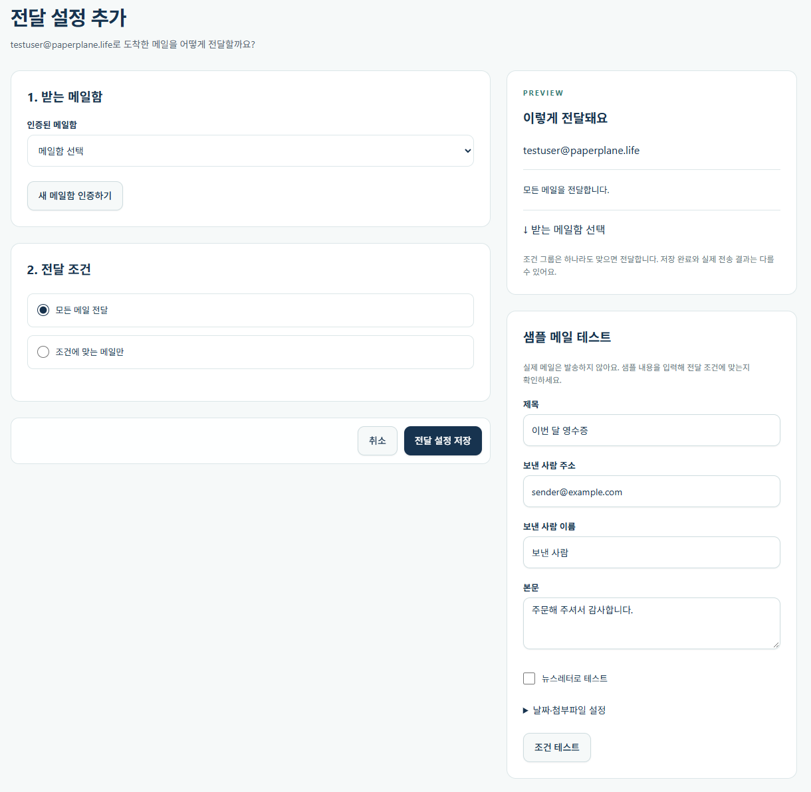

### 전달 기록 확인

주소별 전달 대상과 처리 시각·상태를 확인합니다. 이 기록은 애플리케이션의 처리 이벤트이며, 목적지 메일 서버의 최종 수락 여부는 Postfix 로그에서 확인합니다.

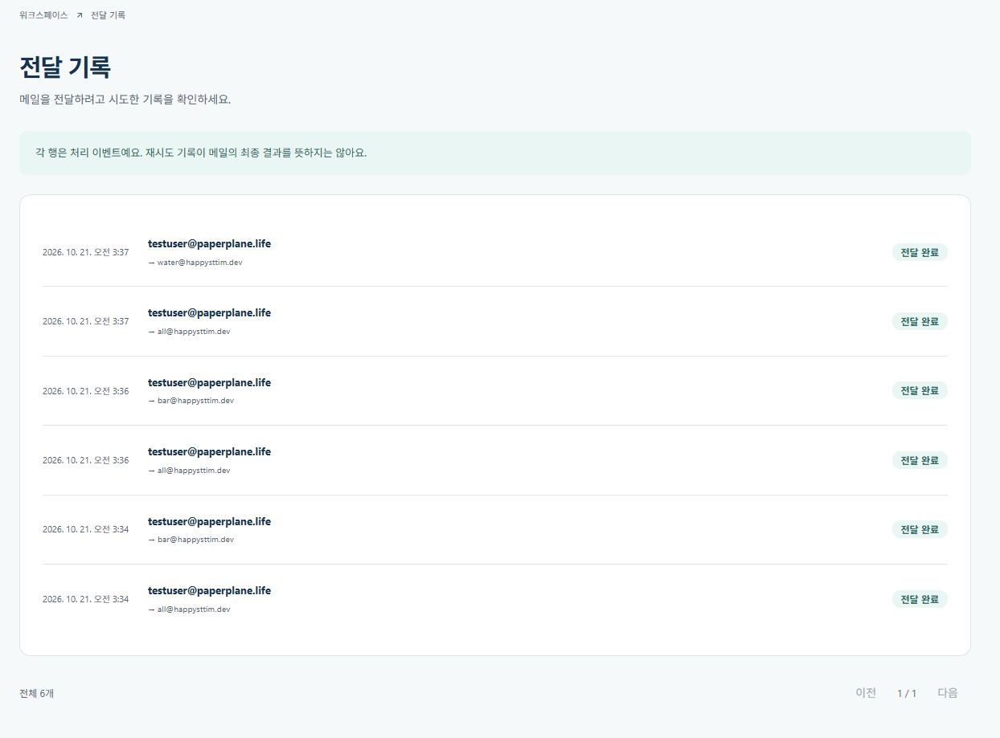

## 사용방법

Docker Desktop의 Linux 엔진이 필요합니다. 로컬 개발에는 Node.js 22와 pnpm 9.4를 사용합니다.
아래 명령은 저장소 루트에서 실행합니다.

1. `.env.example`을 `.env.development`로 복사하고 DB 비밀번호, 도메인, 웹 주소와 OAuth 값을 입력합니다. 기존 환경 파일은 재사용합니다.
2. `pnpm install` 후, 인증 키가 없는 최초 실행에만 `pnpm --filter @apps/api keys:generate`를 실행합니다.
3. [DKIM 개인키](apps/postfix/dkim/README.md)와 [TLS 인증서](apps/postfix/certs/README.md)를 준비합니다.
4. 전체 서비스를 실행합니다.

```powershell
docker --context desktop-linux compose --env-file .env.development up -d --build
docker --context desktop-linux compose --env-file .env.development ps -a
```

웹은 `http://localhost:<WEB_PORT>`에서 접속합니다. 예시 파일은 8088, 현재 개발 설정은 5173입니다.
`WEB_ORIGIN`과 OAuth 콜백도 접속 주소에 맞춥니다. 컨테이너는 루트 환경 파일을 사용합니다.
마이그레이션과 Postfix DB 조회 권한은 자동 적용되며, 사용할 도메인은 다음처럼 등록합니다.

```powershell
docker --context desktop-linux compose --env-file .env.development exec postgres psql -U postgres -d paperplane -c "INSERT INTO domains (name) VALUES ('paperplane.life') ON CONFLICT DO NOTHING;"
docker --context desktop-linux compose --env-file .env.development logs -f api smtp postfix
docker --context desktop-linux compose --env-file .env.development down
```

`down`은 데이터를 보존합니다. `down -v`는 DB와 메일 큐 볼륨을 삭제합니다.
일반 Linux에서는 `--context desktop-linux`를 생략합니다.
