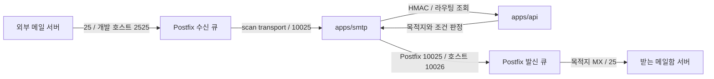

# Paperplane Postfix

Debian 공식 이미지에 배포판의 Postfix 패키지를 설치하는 Docker 이미지와 Compose 설정입니다. `apps/smtp`의 현재 포트·전달 방식에 맞춰 수신과 재주입 경로를 나눴습니다. API·DB·SMTP 애플리케이션은 이 Compose가 실행하지 않습니다.

## 메일 흐름



외부 `25` 리스너는 PostgreSQL의 `domains.name`과 `emails.src_email`에 등록된 도메인·수신 주소를 RCPT 단계에서 조회합니다. 미등록 수신자는 거절하고, DB 조회 실패는 임시 오류로 처리합니다. 수신한 메일은 큐에 저장한 다음 `apps/smtp`로 전달합니다. 애플리케이션이 다시 보낸 메일은 `10025` 리스너에서 `content_filter`를 비워 재분석 루프를 막습니다. 재주입 리스너는 지정한 신뢰 IP/CIDR만 허용하고, 호스트에서는 `127.0.0.1`로만 공개합니다.

## 실행

Docker Desktop의 Linux 컨테이너 엔진 또는 Linux Docker Engine을 먼저 실행하세요.

Windows에서 기본 context가 잘못된 엔진을 가리키면 아래 명령의 `docker`를 `docker --context desktop-linux`로 바꾸면 됩니다. 이 작업의 이미지 검증에도 해당 context를 명시했습니다.

```powershell
cd apps/postfix
Copy-Item .env.example .env
# 아래 PostgreSQL 준비 절차를 먼저 완료하고 .env의 DB 비밀번호, 호스트명, SMTP 앱 주소를 수정하세요.
docker compose config --quiet
docker compose up -d --build
docker compose ps
docker compose logs -f postfix
```

이미 `.env`를 작성했다면 복사 명령은 생략하세요. 기본값은 `.example` 도메인과 로컬 테스트 포트이므로 실제 인터넷 메일은 들어오지 않습니다. 이미지 이름은 `paperplane/postfix:local`이며 로컬에서 빌드합니다.

| 설정 | 기본값 | 역할 |
| --- | --- | --- |
| `POSTFIX_HOSTNAME` | `mail.paperplane.example` | Postfix 호스트명/EHLO 이름 |
| `POSTFIX_DB_HOST` / `POSTFIX_DB_PORT` | `postgres` / `5432` | DB 내부 접속 주소 |
| `POSTFIX_DB_NAME` / `POSTFIX_DB_USER` | `paperplane` / `paperplane_postfix` | DB와 조회 계정 |
| `POSTFIX_DB_PASSWORD` | 필수 | database 프로젝트의 같은 변수와 일치 |
| `SMTP_BIND_ADDRESS` | `127.0.0.1` | 외부 수신 리스너의 호스트 바인딩 |
| `SMTP_PUBLIC_PORT` | `2525` | 개발 환경 수신 포트; 운영 MX는 `25` |
| `SMTP_REINJECT_PORT` | `10026` | 호스트 앱 → Postfix 재주입 포트 |
| `FILTER_SMTP_HOST` | `host.docker.internal` | Postfix → SMTP 앱 주소 |
| `FILTER_SMTP_PORT` | `10025` | SMTP 앱의 `LISTEN_PORT` |
| `MAIL_NETWORK_SUBNET` | `172.30.25.0/24` | Docker 전용 네트워크 |
| `POSTFIX_TRUSTED_NETWORKS` | `127.0.0.0/8,172.30.25.0/24` | 재주입을 허용하는 앱 네트워크 |
| `POSTFIX_MESSAGE_SIZE_LIMIT` | `26214400` | 최대 메일 크기, 25 MiB |

서브넷이 다른 프로젝트와 겹치면 `MAIL_NETWORK_SUBNET`과 `POSTFIX_TRUSTED_NETWORKS`를 함께 변경하세요. Docker가 전달하는 호스트 클라이언트 IP는 플랫폼에 따라 다를 수 있습니다. 호스트 앱이 재주입에서 거절되면 로그의 실제 클라이언트 IP를 확인해 필요한 IP의 `/32`만 추가하세요. 신뢰 범위를 전체 인터넷으로 넓히지 마세요.

## PostgreSQL 조회 준비

1. `apps/database/.env`를 설정하고 해당 Compose를 먼저 실행합니다. `paperplane-database` 네트워크를 자동 생성합니다.
2. API 마이그레이션으로 테이블을 생성한 다음 저장소 루트에서 아래 권한 SQL을 실행합니다.

```powershell
docker compose --project-directory apps/database exec -T postgres psql -U postgres -d paperplane -f /opt/paperplane/grant-postfix.sql
```

3. Postfix `.env`의 `POSTFIX_DB_PASSWORD`를 database 프로젝트의 같은 값으로 맞춥니다. 공백·개행 없는 비밀번호를 사용합니다.
4. Postfix 이미지를 다시 빌드하고 실행합니다. `postfix-pgsql` 패키지가 필요하므로 재시작만으로는 반영되지 않습니다.

`config/pgsql/relay-domains.cf`와 `relay-recipients.cf`에는 database 프로젝트의 접속 정보
(`hosts = postgres:5432`, `dbname = paperplane`, `user = paperplane_postfix`)와 조회 SQL을 명시합니다.
`postgres`는 프로젝트 폴더명이 아니라 database Compose의 서비스 이름입니다.
기존 `POSTFIX_DB_HOST/PORT/NAME/USER` 환경 변수로 접속 정보를 덮어쓸 수 있습니다.
컨테이너 시작 시 접속 정보를 추가해 `/etc/postfix/pgsql/`에 생성하고 `root:postfix`, `0640` 권한을 적용합니다.
비밀번호를 이미지에 저장하지 않습니다. Docker 관리 권한으로 환경 변수를 볼 수는 있습니다.
SQL은 일치하는 행이 있을 때만 `1`을 반환합니다. `SELECT EXISTS`로 `false` 행을 반환하면 존재하는 키로 취급될 수 있어 사용하지 않습니다.
일반 수신만 검사하며 재주입 포트는 기존 `no_unknown_recipient_checks` 설정을 유지합니다.

Postfix 폴더에서 실제 등록된 값으로 조회를 확인할 수 있습니다.

```powershell
docker compose exec postfix postconf -m
docker compose exec postfix postmap -q paperplane.example pgsql:/etc/postfix/pgsql/relay-domains.cf
docker compose exec postfix postmap -q test@paperplane.example pgsql:/etc/postfix/pgsql/relay-recipients.cf
```

등록된 값은 `1`, 미등록 값은 결과 없음, 연결·권한 오류는 오류 로그로 구분합니다.
Compose의 상태 검사는 DB 조회 성공을 검사하지 않습니다.

## SMTP 애플리케이션 연결

현재 `apps/smtp`를 Docker **호스트**에서 실행할 때의 설정입니다. `apps/smtp/.env`에 반영하세요.

```dotenv
LISTEN_PORT=10025
POSTFIX=127.0.0.1
POSTFIX_PORT=10026
REQUEST_ROUTE=http://127.0.0.1:8080/api/v1/router
REQUEST_RECORD=http://127.0.0.1:8080/api/v1/internal/deliveries
HMAC_KEY_PATH=/absolute/path/to/shared-hmac.key
```

`HMAC_KEY_PATH`는 API 내부 요청 검증용 키와 같아야 합니다. Postfix 자체에는 이 키가 필요하지 않습니다. 경로는 실행 환경에 맞게 바꾸세요. 호스트의 SMTP 앱은 Docker에서 접근 가능한 인터페이스로 수신해야 합니다. 해당 앱 포트는 공개 인터넷에서 접근하지 못하게 제한하세요. 기본 `server.listen(port)`는 모든 인터페이스에 바인딩할 수 있습니다.

향후 SMTP 앱을 컨테이너로 실행한다면:

- 애플리케이션 서비스를 `paperplane-mail` 네트워크에 연결하고 서비스 이름을 `smtp`로 지정합니다.
- Postfix `.env`의 `FILTER_SMTP_HOST=smtp`로 변경합니다.
- 앱은 `LISTEN_PORT=10025`, `POSTFIX=postfix`, `POSTFIX_PORT=10025`를 사용합니다. 서로 다른 컨테이너이므로 같은 포트여도 충돌하지 않습니다.
- API URL은 같은 네트워크의 API 서비스 주소로 변경합니다. 앱 컨테이너의 `localhost`는 호스트 API가 아닙니다.
- 이 네트워크에는 재주입을 허용할 신뢰한 서비스만 연결합니다. 사설 앱 연결 구간은 현재 SMTP 앱에 맞춰 평문 SMTP입니다. 외부 수신과 원격 MX 발신은 STARTTLS를 사용 가능한 경우 협상합니다.

## 운영 도메인과 TLS

### OpenDKIM 서명

OpenDKIM은 별도 컨테이너로 실행하며 `dkim/mail202610.private`를 읽기 전용으로 마운트합니다.
해당 폴더는 Git과 이미지 빌드에서 제외됩니다. 원본 키는 변경하지 않고 컨테이너 tmpfs에
전용 사용자·0600 권한으로 복사하여 사용합니다. 인증서의 `privkey.pem`과는 다른 키입니다.

- 서명 도메인: `paperplane.life`
- 선택자: `mail202610`
- DNS TXT: `mail202610._domainkey.paperplane.life`에 같은 쌍의 공개키 등록
- 설정: `config/opendkim.conf`
- Milter: `opendkim:8891`, Postfix와만 공유하는 내부 네트워크, 호스트 미공개

API 인증 메일은 **서명 전용 10027 포트**를 사용합니다. 루트 Compose의 API 연결도 변경했습니다.
개별 Postfix Compose에서는 호스트 `127.0.0.1:10027`로 연결할 수 있습니다.
기존 SMTP 앱의 전달 포트 `10025`는 그대로 유지하며 외부 전달 메일에는 서명을 추가하지 않습니다.
서명 전용 포트는 신뢰 네트워크만 허용하고, OpenDKIM 장애 시 임시 실패를 반환합니다.
OpenDKIM은 `ORIGINATING` MTA와 `paperplane.life` From 도메인에 대해 서명합니다.
이 포트는 인증 없는 내부 발신 인터페이스이므로 외부 인터넷에 공개하면 안 됩니다.

저장소 루트에서 반영합니다. 기존 API 컨테이너도 새 발신 포트 환경 변수로 재생성합니다.

```powershell
docker --context desktop-linux compose --env-file .env.development up -d --build opendkim postfix api
docker --context desktop-linux compose --env-file .env.development ps
```

키 변경 시 DNS와 짝을 맞춘 후 `opendkim`을 재시작합니다. 키는 자동 생성하거나 교체하지 않습니다.
DNS 전파·키 일치 확인은 실행 중인 OpenDKIM에서 다음 명령으로 할 수 있습니다.
내부 네트워크 환경에서 DNS 조회가 차단되어 있으면 별도 DNS 접근 가능한 환경에서 검사해야 합니다.

```powershell
docker --context desktop-linux compose --env-file .env.development exec opendkim opendkim-testkey -d paperplane.life -s mail202610 -k /run/opendkim/mail202610.private -vvv
```

임시 키·외부 통신 차단 네트워크에서 DATA 처리 후 큐의 서명을 공개키로 검증하여 PASS를 확인했습니다.
전달 포트 및 외부 From 도메인 서명 제외와 서명 서비스 중단 시 4xx 반환도 확인했습니다.
사용자 개인키의 RSA 형식은 검사했지만 공개 DNS와의 일치 및 실제 외부 메일함 도착은 검증하지 않았습니다.

- [OpenDKIM MTA/Domain 설정](https://manpages.debian.org/bookworm/opendkim/opendkim.conf.5.en.html)
- [Postfix Milter 연동](https://www.postfix.org/MILTER_README.html)

1. `domains.name`과 `emails.src_email`에 운영 도메인과 전체 수신 주소를 등록합니다. SQL은 저장된 값과 비교하므로 API와 동일한 소문자 정규화를 사용하세요. 정적 도메인 환경 변수는 더 이상 사용하지 않습니다.
2. 운영 도메인의 MX를 `POSTFIX_HOSTNAME`으로 지정하고 해당 호스트의 A/PTR을 준비합니다. 이 구성은 IPv4용입니다.
3. 운영 수신에는 `SMTP_BIND_ADDRESS=0.0.0.0`, `SMTP_PUBLIC_PORT=25`와 호스트 방화벽·인바운드 TCP 25가 필요합니다. 기본 발신은 외부 MX로 직접 연결하므로 아웃바운드 TCP 25도 필요합니다. 인증형 외부 smarthost는 이 구성에 포함하지 않습니다.
4. `certs/fullchain.pem`, `certs/privkey.pem`을 넣고 재시작합니다. 없으면 30일짜리 테스트용 self-signed 인증서를 데이터 볼륨에 생성합니다. 인증서 자동 발급·갱신은 포함하지 않습니다.
5. SPF/DKIM/DMARC와 전달 메일의 SRS/ARC 정책은 별도 구성·검증 대상입니다. 이 Compose만으로 외부 사업자의 수신함 도착을 보장하지 않습니다.

## 큐·로그 확인

```powershell
docker compose exec postfix postconf -n
docker compose exec postfix postconf -M
docker compose exec postfix postqueue -p
docker compose logs --tail 100 postfix
docker compose restart postfix
docker compose down
```

큐(`/var/spool/postfix`)와 런타임 데이터(`/var/lib/postfix`)는 named volume으로 유지됩니다. `down -v`는 대기 메일까지 지우므로 사용하지 마세요. Healthcheck는 Postfix 프로세스와 두 수신 포트만 확인하며 API·SMTP 앱·외부 전송 성공을 보장하지 않습니다. SMTP 앱에 접속할 수 없으면 Postfix 큐에서 재시도합니다.

SMTP 앱은 API 조회 실패에 `451`을 반환해 Postfix가 재시도하도록 합니다. `sent` 기록은 최종 메일함 도착이 아니라 Postfix의 큐 수락을 뜻합니다. 일부 목적지만 성공한 뒤 원본이 재시도되면 중복 전달될 수 있으며 목적지별 영속 상태와 최종 전송 결과 기록은 별도 보완 대상입니다.

## 이전 정적 맵 구성의 검증 기록

아래 결과는 pgsql 변경 전 정적 맵 구성의 기록이며 현재 DB 연동의 검증 결과가 아닙니다. Compose v2.23.3 설정 검사와 POSIX 셸 문법 검사를 통과했습니다. Docker Desktop Linux 엔진에서 이미지 빌드와 Postfix 3.7.11 시작을 확인했습니다. 호스트 포트를 공개하지 않고 `--network none`인 일회용 컨테이너에서 아래 항목을 검사했습니다.

| 검사 | 결과 |
| --- | --- |
| Postfix 시작·설정 검사 | 성공 |
| `25`에서 `test@paperplane.example` 수신자 | `250 2.1.5 Ok` |
| `25`에서 `test@other.example` 릴레이 | `554 5.7.1 Relay access denied` |
| 신뢰한 로컬 클라이언트의 `10025` 재주입 | `250 2.1.5 Ok` |
| 재주입 리스너 `content_filter` | 빈 값, 재필터링 해제 |

SMTP 검사는 RCPT 단계까지만 수행하여 실제 메일을 발송하지 않았습니다. API/SMTP 앱을 포함한 전체 메일 흐름, 실제 인증서, 외부 MX 최종 전달 및 큐 재시도/복구는 운영 환경에서 추가 검증해야 합니다.

## 참고

- [Postfix PostgreSQL 조회 파일 형식](https://www.postfix.org/pgsql_table.5.html)

- [Postfix 공식 after-queue filter 구성](https://www.postfix.org/FILTER_README.html)
- [Postfix SMTP 접근 제어](https://www.postfix.org/SMTPD_ACCESS_README.html)
- [Postfix stdout 로그](https://www.postfix.org/MAILLOG_README.html)
- [Debian Docker 공식 이미지](https://hub.docker.com/_/debian)
- [Docker Compose 네트워크](https://docs.docker.com/compose/how-tos/networking/)

