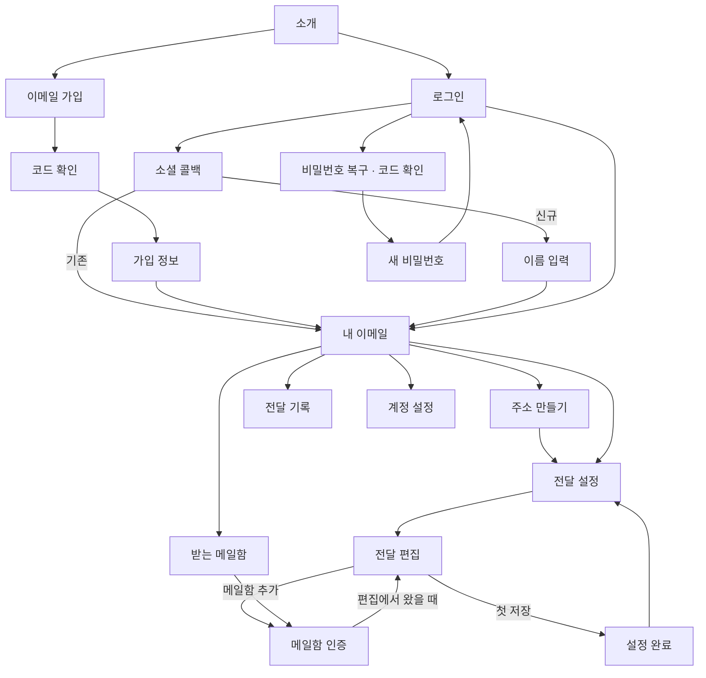

# Paperplane 반응형 UI 상세 설계

2026-10-17 · 문서 와이어프레임 v1 · API 기반 설계안

이 문서는 웹 구현 전에 검토하는 화면·상태 명세다. 실제 사용자 데이터나 운영 중인 전달 상태를 나타내지 않는다. 기존 [제품 기획](../ui-ux-plan.md)을 구체화하며, 세부 동작이 다르면 이 문서의 명시적인 결정을 우선한다.

실제로 클릭해 볼 수 있는 [HTML 프로토타입과 검증 범위](prototype.md)를 추가했습니다. 실행 방법은 [웹 README](../../README.md)를 참고하세요.

## 문서 구성

실제 구현 화면은 [사진으로 보는 반응형 화면 가이드](screen-guide/index.html)에서 확인하세요. 20개 기본 화면과 12개 상호작용 상태를 세 가지 화면 크기로 촬영했습니다. [Markdown 버전](screen-guide/README.md)과 [오프라인 ZIP](paperplane-screen-guide.zip)도 제공합니다.

1. [전체 화면 와이어프레임](pages.md): 화면 20종의 배치, 모바일 변화, 주요 상태와 이동 경로.
2. [상호작용·컴포넌트 명세](interactions.md): 입력, 검증, 저장, 인증, 조건 편집, 삭제, 포커스와 실패 복구.
3. 이 문서: 화면 지도, 반응형 규격, 시각 토큰, 데이터 경계, 제작·검토 기준.

## 화면 지도

아래 URL은 **제안하는 프런트엔드 경로**이며 API 엔드포인트와 다르다. 화면 상태를 URL과 일대일로 만들 필요는 없다.

| ID | 화면 | 경로 또는 진입 방식 | 로그인 |
| --- | --- | --- | --- |
| P01 | 서비스 소개 | `/` | 불필요 |
| P02 | 로그인 | `/login` | 불필요 |
| P03 | 이메일 가입 시작 | `/signup` | 불필요 |
| P04 | 가입 코드 확인 | `/signup/verify` | 인증 흐름 필요 |
| P05 | 가입 정보 입력 | `/signup/profile` | 인증 완료 필요 |
| P06 | 소셜 인증 결과 처리 | `/auth/:provider/callback` | OAuth 흐름 필요 |
| P07 | 소셜 신규 가입 | `/signup/social` | 소셜 인증 완료 필요 |
| P08 | 비밀번호 복구·코드 확인 | `/password/reset` | 불필요 |
| P09 | 새 비밀번호 설정 | `/password/reset/new` | 복구 인증 완료 필요 |
| P10 | 내 이메일 | `/emails?page=1` | 필요 |
| P11 | 주소 만들기 | `/emails/new` | 필요 |
| P12 | 주소별 전달 설정 | `/emails?page=1&selected=123` | 필요 |
| P13 | 전달 추가·편집·조건 테스트 | P12의 편집 화면. URL에 `edit` 추가 가능 | 필요 |
| P14 | 받는 메일함 목록 | `/destinations` | 필요 |
| P15 | 메일함 추가·코드 확인 | `/destinations/new` | 필요 |
| P16 | 전달 기록·기록 상세 | `/deliveries?page=1` | 필요 |
| P17 | 계정 설정 | `/settings` | 필요 |
| P18 | 찾을 수 없는 페이지 | 일치하지 않는 경로 | 공통 |
| P19 | 접근 복구·서비스 오류 | 세션 복구 실패, 중요 데이터 로드 실패 | 공통 상태 |
| P20 | 첫 설정 완료 | 첫 규칙 저장 후 P12의 완료 상태 | 필요 |

약관·개인정보 처리방침은 내용이 확정되면 별도 공개 문서 경로로 연결한다. 임의로 정책·보관기간·동의 문구를 확정하지 않는다. 공개 출시 검토 시 실제 정책 문서가 필요하며, 존재하지 않는 링크를 미리 표시하지 않는다.

## 제품 표현의 기준

- 홈은 ‘내 이메일’. 통계 카드·플랜 배너·광고 영역을 두지 않는다.
- 주소 목록의 ‘설정 완료’는 인증된 목적지와 규칙이 있다는 뜻이다. 실제 메일 수신·발송 성공을 뜻하지 않는다.
- 전달 기록은 이벤트 목록이다. 최신 페이지의 일부 결과로 전체 성공률이나 현재 메일 상태를 추정하지 않는다.
- 규칙 테스트는 샘플 판정이며 발송하지 않는다.
- 목적지 인증은 사용자 소유 확인이다. 실제 전달 경로의 가용성 확인이 아니다.
- 프리미엄, 메일함 본문 열람, 주소 수정, 규칙 이름·순서·활성화, 전체 검색, 수동 재전송 기능을 노출하지 않는다.

## 반응형 규격

| 모드 | 기준 폭 | 셸 | 콘텐츠 | 주요 조정 |
| --- | --- | --- | --- | --- |
| 작은 모바일 | 320~374px | 상단 56px + 하단 탐색 | 좌우 16px | 긴 버튼 문구 줄바꿈, 주소 단어 단위 강제 줄바꿈, 조건 입력 전체 폭 |
| 모바일 | 375~767px | 상단 56px + 하단 탐색 | 좌우 20px | 목록→카드, 폼 한 열, 상세·편집은 전체 화면 |
| 태블릿 | 768~1023px | 상단 64px, 가로 메뉴 | 좌우 24px | 본문 최대 880px, 조건 폼 한 열 유지, 목록 행 사용 가능 |
| 데스크톱 | 1024~1439px | 왼쪽 224px 메뉴 | 좌우 32px | 폼 최대 720px, 본문 최대 1120px |
| 넓은 화면 | 1440px 이상 | 동일 메뉴 | 가용 영역 안 가운데 정렬 | 본문을 무한 확장하지 않음, 편집 설명을 우측 260px에 배치 가능 |

로그인·가입 화면은 공용 셸을 사용한다. 데스크톱은 설명 영역과 최대 440px 폼, 태블릿은 중앙 폼과 짧은 설명, 모바일은 로고·뒤로·폼 순서다. 공개 소개 화면은 중앙 최대 1120px 레이아웃이며 계정용 사이드바가 없다.

### 스크롤·키보드

- 페이지 전체에 주 스크롤 하나. 데스크톱의 탐색 메뉴는 독립적으로 스크롤 가능하되 본문에 중첩된 고정 높이 목록을 만들지 않는다.
- 모바일 상세·편집에서는 하단 전역 탐색을 숨기고 저장 영역으로 교체한다. 목록 화면에서는 탐색을 유지한다.
- 바닥 영역은 `safe-area-inset-bottom`을 반영하고 본문에 같은 높이의 여백을 둔다.
- 소프트 키보드가 열린 때 저장 버튼이 필드를 덮지 않도록 문서 흐름 안으로 전환한다. 포커스된 필드·오류 메시지를 함께 보이게 한다.
- 200% 확대에서도 기능을 유지하며 400% 확대 시 모바일 배치로 자연스럽게 재배치한다.
- 긴 주소·실패 상세·messageId는 레이아웃 밖으로 나가지 않는다. 중요한 값을 생략했으면 전체 보기·복사를 제공한다.

## 시각 토큰

| 토큰 | 값 | 사용 |
| --- | --- | --- |
| 배경 | `#F7FAFA` | 앱 전체 |
| 표면 | `#FFFFFF` | 폼·행·대화상자 |
| 주색 | `#17324D` | 제목, 주 버튼 |
| 민트 | `#4DB6AC` | 로고, 작은 장식 |
| 연한 민트 | `#E9F6F3` | 선택 배경, 완료 안내 |
| 보조 글자 | `#526571` | 설명·메타데이터 |
| 경계선 | `#DCE6E8` | 표면 구분 |
| 오류 | `#B42318` | 오류 글자·삭제 버튼 |
| 성공 | `#176B4A` | 성공 글자·아이콘 |
| 주의 | `#8A4B08` | 주의 안내 |
| 포커스 | `#176C82` | 2px outline + 2px offset |
| 글꼴 | 시스템 한글 고딕 | 별도 외부 폰트 로딩 없이 시작 |
| 글자 | 제목 28/36, 섹션 20/28, 본문 16/24, 보조 14/20px | 모바일 페이지 제목 24/32px |
| 모서리 | 입력·버튼 10px, 패널 12px | 알약 모양은 작은 상태 배지에만 사용 |
| 간격 | 4, 8, 12, 16, 24, 32, 48px | 폼 항목 20~24px, 섹션 32px |
| 입력·버튼 | 기본 48px, 아이콘 터치 영역 최소 44px | 모바일 동일 |

색 대비는 구현 시 실제 배경 조합으로 검증한다. 민트 위 흰 글자의 작은 텍스트는 피하고 주 버튼은 네이비+흰색으로 사용한다. 상태는 색·아이콘·명칭을 함께 사용한다. 다크 모드는 첫 버전에 포함하지 않되 운영체제 다크 모드에서도 폼 색이 임의로 뒤집히지 않도록 한다.

## 데이터·권한·URL 원칙

1. 이메일 목록은 10개, 기록은 20개씩 서버 페이지를 따른다. 페이지 이동 시 제목·오류·로딩 상태를 접근 가능하게 안내한다.
2. 주소 상세는 현재 페이지 응답에서 찾는다. 직접 진입한 페이지에 ID가 없으면 ‘목록에서 주소를 다시 선택해 주세요.’와 목록 복귀를 제공한다. 없는 단건 API를 가정하지 않는다.
3. 인증 토큰·코드·비밀번호·샘플 본문을 URL이나 localStorage에 넣지 않는다. 입력 초안과 인증 상태는 메모리에서 유지하고 리로드 시 필요한 단계를 다시 진행한다.
4. 소셜 리다이렉트에 필요한 state·OAuth용 CSRF nonce·허용된 returnTo는 탭의 sessionStorage에 일시 보관한다. 인증 JWT·verifyToken·비밀번호·인증코드는 포함하지 않는다. 콜백 처리 후 저장값과 URL의 code/state를 제거한다.
5. `returnTo`는 앱 내부 허용 경로만 허용한다. 외부 URL로 인증 후 이동하지 않는다.
6. 페이지 새로고침은 세션 복구 후 데이터를 조회한다. 미저장 초안이 서버에 저장됐다고 표현하지 않는다.
7. 인증 메일 전송, 주소 생성, 규칙 저장, 삭제는 자동으로 반복하지 않는다. 결과가 불명확하면 목록 조회로 확인한다.

## 제작물·검토 순서

| 단계 | 디자인 검토물 | 통과 조건 |
| --- | --- | --- |
| 1 | P01~P09 + 공통 폼 상태 | 가입·소셜·복구 흐름에서 갈 곳 없는 상태가 없음 |
| 2 | P10~P15·P20 | 첫 주소와 인증 목적지 연결이 데스크톱·모바일에서 완결됨 |
| 3 | 조건 편집·테스트 상태 | 저장된 규칙의 의미와 자연어 요약·편집 값이 동일함 |
| 4 | P16~P19·삭제 확인 | 데이터 부재·오류·종속 삭제가 오해 없이 표시됨 |
| 5 | 모든 화면의 키보드·확대·느린 네트워크 | 콘텐츠 가림·포커스 유실·중복 저장이 없음 |

검토용 대표 뷰포트는 360×800, 390×844, 768×1024, 1024×768, 1440×900이다. 320px·긴 이메일·긴 한글 이름·200% 확대를 추가 경계값으로 확인한다. 와이어프레임의 주소와 기록은 설명용이며 실제 운영 데이터가 아니다.
