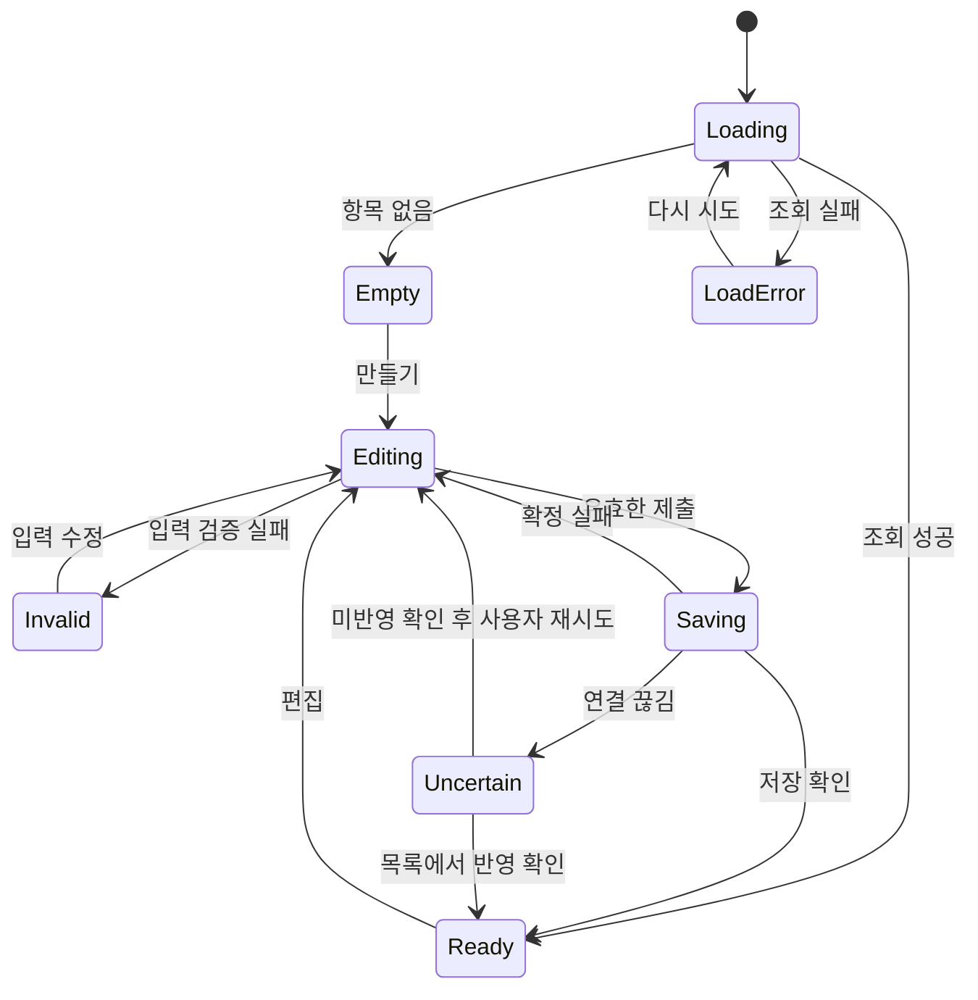

# 상호작용·상태·컴포넌트 명세

[설계 목차](README.md) · [화면 와이어프레임](pages.md)

## 1. 전역 상태 모델

| 상태 | 표시 | 가능한 동작 | 다음 상태 |
| --- | --- | --- | --- |
| 초기 인증 확인 | 셸 + ‘로그인 확인 중’ | 공개 페이지로 이동 | 로그인 필요 또는 데이터 로딩 |
| 최초 데이터 로딩 | 콘텐츠 형태의 스켈레톤 | 메뉴 이동 | 목록·빈 상태·조회 실패 |
| 정상 조회 | 실제 콘텐츠 | 조회·편집 | 갱신 중·변경 있음 |
| 백그라운드 갱신 | 기존 콘텐츠 + 작은 갱신 표시 | 기존 값 열람 | 최신 콘텐츠 또는 갱신 실패 배너 |
| 빈 결과 | 빈 상태 설명 + 주 행동 하나 | 생성·추가 | 생성 폼 |
| 폼 편집 | 현재 입력 + 필요한 보조 설명 | 수정·취소·검증 | 유효 또는 오류 |
| 저장 중 | ‘저장 중…’ + 중복 제출 차단 | 현재 진행 상태 확인 | 성공·확정 실패·결과 불명확 |
| 확정 실패 | 폼 유지 + 위치별 오류 | 수정 후 재시도 | 편집 |
| 결과 불명확 | ‘결과를 확인하고 있어요.’ | 목록 새로 확인, 안전한 복귀 | 반영 확인 또는 재확인 필요 |
| 완료 | 반영된 콘텐츠 + 짧은 성공 안내 | 다음 행동 | 정상 조회 |

상태는 컴포넌트 단위다. 한 규칙 저장 실패 때문에 전체 메뉴와 목록을 사용할 수 없게 만들지 않는다. 제출 중 뒤로 가거나 페이지를 나갔다고 해서 서버 요청이 취소됐다고 표현하지 않는다.



## 2. 디자인 컴포넌트 계약

| 컴포넌트 | 기본·상호작용 상태 | 세부 규칙 |
| --- | --- | --- |
| 주 버튼 | default / hover / focus / pressed / disabled / loading | 클릭 후 폭 유지, 진행 문구로 변경. 로딩 아이콘만 표시하지 않음 |
| 보조 버튼 | 같은 상태 | 취소·복사·테스트. 삭제용 주 버튼과 색을 구분 |
| 아이콘 버튼 | hover 툴팁 + accessible name | 툴팁에만 의미를 의존하지 않음. 모바일도 44px 터치 영역 |
| 텍스트 입력 | empty / focused / filled / invalid / disabled / readonly | 레이블 항상 유지, placeholder는 예시만. 오류 영역은 필드 바로 아래 |
| 비밀번호 | 숨김 / 표시 + 오류 | 보기 버튼이 커서를 잃게 하지 않음. 붙여넣기·비밀번호 관리자를 허용 |
| 코드 입력 | 숫자 6자리 / 확인 중 / 오류 / 재발송 필요 | 단일 입력, 선행 0 보존, 자동 제출 없음 |
| 선택 | 닫힘 / 열림 / 선택 / 빈 목록 | 키보드 방향키·Enter·Escape. 선택 후 원래 필드에 포커스 |
| 라디오 | 미선택 / 선택 / focus | 전체 라벨 클릭 가능. 선택 바뀜으로 생긴 폼의 첫 필드로 자동 점프하지 않음 |
| 상태 배지 | 설정 필요 / 인증 필요 / 설정 완료 | 아이콘+텍스트. 서버 전송 성공과 시각적으로 구별 |
| 아코디언 | 닫힘 / 열림 | 헤더 버튼에 expanded 상태. 열 때 포커스는 버튼에 유지 |
| 행 더보기 | 닫힘 / 열림 | 가능한 행동만 렌더링. Escape·바깥 클릭으로 닫고 트리거로 포커스 복귀 |
| 토스트 | 성공 / 보조 알림 | 성공은 약 4초, 포커스·호버 중 시간 정지. 같은 메시지 중복 쌓기 금지 |
| 확인 대화상자 | 열림 / 처리 중 / 실패 | 취소에 최초 포커스, 닫힐 때 트리거 복귀. 제출 중 닫아도 서버 취소 아님 |
| 스켈레톤 | 최초 로딩 | 실제 행 구조와 높이 유사. reduced-motion에서는 반짝임 제거 |
| 페이지 이동 | 이전 / 현재 / 다음 | 첫·마지막 페이지 비활성. 현재 페이지를 텍스트로 알림 |
| 인라인 배너 | 주의 / 실패 / 참고 | 오류 원인과 다음 행동 포함. 자동으로 사라지지 않음 |

버튼 비활성만으로 오류를 설명하지 않는다. 왜 사용할 수 없는지 가까이에 보조 설명을 둔다. 필수 입력이 비었더라도 사용자가 제출하면 필요한 필드가 드러나도록 검증할 수 있다. 네트워크 작업 중이거나 도메인·인증 컨텍스트가 없을 때는 제출을 실제로 잠근다.

## 3. 폼 검증과 포커스

1. 최초 입력 중에는 불필요한 빨간 오류를 표시하지 않는다. blur 또는 첫 제출 후 해당 필드 검증을 시작한다.
2. 오류가 표시된 필드는 수정 중 검증해서 해결되면 제거한다. 서버 중복 오류는 주소를 바꾸기 전까지 유지한다.
3. 여러 오류가 있으면 첫 오류 필드로 이동하고 상단에 짧은 요약을 제공한다. 그 필드·설명·오류를 함께 연결한다.
4. 신규 조건을 추가하면 새 조건의 필드 선택에 포커스. 삭제하면 다음 조건 또는 이전 조건의 삭제 버튼으로 복귀한다.
5. 문맥이 유지되는 목록 갱신은 스크롤 위치를 유지한다. 새 화면 이동은 페이지 제목으로 포커스를 옮긴다.
6. 화면 진입 시 자동으로 텍스트 필드에 포커스를 넣어 모바일 키보드를 강제로 열지 않는다. 인증 코드 전송 후 사용자 행동의 결과로 코드 입력에 포커스하는 것은 허용한다.

| 필드 | 검증 | 문구 예시 |
| --- | --- | --- |
| 이름 | 2~8자, 공백 정리 후 확인 | ‘이름은 2~8자로 입력해 주세요.’ |
| 이메일 | 유효 형식, 전체 254자 이하 | ‘이메일 주소를 확인해 주세요.’ |
| 비밀번호 | 8자 이상, 서버와 같은 특수문자 조건 | ‘8자 이상, 특수문자를 포함해 주세요.’ |
| 비밀번호 확인 | 일치 | ‘비밀번호가 일치하지 않아요.’ |
| 코드 | 숫자 6자리 문자열 | ‘6자리 인증번호를 입력해 주세요.’ |
| 주소 앞부분 | 도메인과 조합한 전체 이메일 검증 | ‘만들 주소를 확인해 주세요.’ |
| 조건 검색어 | 프런트에서 공백뿐인 값 금지 | ‘조건으로 사용할 내용을 입력해 주세요.’ |
| 날짜 | 시작 ≤ 종료, 유효 날짜 | ‘종료 날짜는 시작 날짜 이후로 선택해 주세요.’ |
| 첨부 확장자 | 비어 있지 않은 확장자, 입력 선행 점 정리 | ‘예: pdf’ |

중요: 기존 API가 비밀번호 앞뒤 공백을 정리하는 동작을 갖고 있다. 프런트엔드가 별도의 다른 규칙을 추가하지 말고 현재 동작을 일치시켜야 한다. 향후 비밀번호 처리 변경 시 API와 함께 변경한다.

## 4. 인증 플로와 지속성

### 일반 진입

- 공개 화면에선 불필요한 보호 API 조회를 하지 않는다.
- 로그인·가입 등 쓰기 요청 전에 CSRF 세션을 준비한다.
- 보호 경로 리로드: CSRF 준비 → Refresh Token으로 갱신 → 내 정보 조회 → 페이지 데이터 조회.
- Access Token은 메모리에만 보관한다. JWT나 비밀번호를 localStorage에 넣지 않는다.
- 로그인·가입 성공 응답의 새 CSRF 토큰을 반영한다. 기존 CSRF 값으로 다음 제출을 보내지 않는다.
- 동시 갱신은 클라이언트에서 하나의 진행 중 Promise를 공유한다. 갱신 성공 시 기다리는 요청은 새 토큰을 사용한다.
- 여러 탭은 세션 쿠키를 공유하므로 다른 탭의 갱신·로그아웃을 고려한다. 만료된 토큰으로 무한 재시도하지 않는다. 탭 알림을 사용한다면 인증 토큰 자체를 방송하지 않고 재확인 필요만 알린다.

### OAuth 왕복

1. CSRF 준비 후 OAuth URL을 받는다.
2. 외부 리다이렉트 전에 탭별 sessionStorage에 현재 OAuth용 CSRF nonce, state, 허용된 returnTo만 짧게 보관한다. 이것은 Access/Refresh JWT 저장과 구분한다.
3. 콜백에서는 기존 세션 쿠키와 보관한 CSRF 값을 사용한다. 먼저 `/auth/csrf`를 다시 호출하면 세션 쿠키가 바뀌어 기존 state 검증이 깨질 수 있다.
4. 서버 교환은 한 번만 요청한다. 중복 렌더링이나 새로고침으로 재요청하지 않도록 처리 중 상태를 관리한다.
5. 성공·실패 후 OAuth용 저장값을 지우고 URL의 code/state도 제거한다. JWT·verifyToken은 메모리에서만 이어간다.
6. 다른 탭에서 세션이 변경됐거나 보관값이 없으면 ‘로그인을 다시 시작해 주세요.’로 복구한다.

### 인증 메일 두 종류

| 항목 | 가입·비밀번호 코드 | 받는 메일함 코드 |
| --- | --- | --- |
| 재발송 간격 | 30초 | 60초 |
| 인증 보관 시간 | 현재 서버 검증 상태 약 30분 | 응답 expiresIn=600초 |
| 확인 시도 | 토큰당 최대 5회 | 한 번 |
| 틀렸을 때 | 다시 입력 또는 제한 시 재인증 | 새 코드 요청 |
| 성공 후 | 가입 정보 또는 새 비밀번호 | 목적지 목록·원래 규칙 편집 |
| 리로드 후 | 인증 컨텍스트가 없으면 시작 화면 | 시작 화면 |

클라이언트 타이머는 보조 안내다. 백그라운드 탭에서 매초 감소시킨 값에 의존하지 말고 수신 시각 기준으로 다시 계산한다. 서버가 거절하면 화면 타이머가 남았어도 서버 판정을 따른다.

가입·재설정 요청은 검증 토큰을 소비할 수 있다. 저장 실패 후 같은 코드가 영구 유효하다고 가정하지 않는다. 입력 정보는 비밀번호를 제외하고 필요한 범위에서 메모리에 유지하며 재인증 경로를 제공한다.

## 5. 주소 상태 판정

주소 상태는 이메일 목록의 forwards와 인증된 destinations 목록을 함께 사용해 계산한다.

| 데이터 | UI 상태 | 주 행동 |
| --- | --- | --- |
| 규칙 0개 | 설정 필요 | 전달 설정하기 |
| 규칙 있음, 모든 목적지가 인증됨 | 설정 완료 | 전달 설정 |
| 규칙 있음, 일부 목적지가 미인증 | 일부 메일함 인증 필요 | 설정 확인 |
| 규칙 있음, 인증 목적지 없음 | 메일함 인증 필요 | 메일함 인증 |
| destinations 조회 실패 | 상태 확인 필요 | 다시 확인 |

규칙의 조건에 어떤 메일도 일치하지 않을 가능성은 별도다. ‘설정 완료’는 조건의 유효성이나 실제 전송 성공을 보장하지 않는다. 규칙 개수는 forwards 길이, 주소 개수는 서버 total을 사용한다. 목적지별 연결 개수는 전체 데이터를 얻지 못했다면 표시하지 않는다.

주소 생성 성공 후 규칙 저장에 실패해도 주소를 자동 삭제하지 않는다. 목록에 ‘설정 필요’로 남아야 한다. 모바일에서 뒤로 가면 이 상태로 이어서 설정할 수 있다.

## 6. 조건 편집기 상세

### 화면 내부 구조

```text
전달 방식
  ● 모든 메일                        → 저장 rule=[]
  ○ 조건에 맞는 메일

조건 그룹 1                     [그룹 삭제]
  다음 필드 조건이 [모두 일치 / 하나 이상 일치]
  제목
    검색어들이 [모두 일치 / 하나 이상 일치]
    [포함 ▾] [영수증                 ] [삭제]
    [시작 ▾] [주문                   ] [삭제]
    + 제목 검색어 추가
  발신 이메일
    [끝 ▾] [@example.com             ] [삭제]
  + 다른 필드 조건 추가

                  또는

조건 그룹 2                     [그룹 삭제]
  뉴스레터 [뉴스레터만 ▾]

+ 또는 조건 그룹 추가
```

첫 그룹은 한 조건 행으로 간결하게 시작한다. 같은 필드의 두 번째 조건이 추가될 때 필드 내부 ‘모두/하나 이상’ 선택을 드러낸다. 같은 필드를 서로 독립된 상위 조건처럼 저장하지 않는다.

### 필드별 컨트롤

| 선택한 필드 | 나타나는 UI | JSON 의미 |
| --- | --- | --- |
| 제목·발신자 이름·이메일·본문 | 포함/시작/끝 + 문자열, 검색어 추가 | 필드별 ForwardRegExp |
| 뉴스레터 | 구분 안 함/뉴스레터만/뉴스레터 제외 | all/true/false. ‘구분 안 함’은 판정 조건에서 제외 |
| 날짜 | 시작·종료 날짜, 기간 추가 | 여러 기간은 OR. 날짜 입력은 사용자의 로컬 시간대 기준 |
| 첨부파일 | 이름 조건 또는 확장자, 조건 추가 | 파일 하나가 첨부 조건을 만족하면 참. 여러 첨부 규칙은 선택한 and/or |

날짜의 종료일은 그 날 끝까지 포함한다. 프런트는 로컬 시작일 00:00부터 종료일 다음 날 직전까지를 UTC ISO로 변환한다. 타임존 전환을 하드코딩한 24시간 덧셈으로 처리하지 않는다. API에서 읽은 기존 시각이 날짜 경계가 아니라면 ‘세부 시간’ 입력을 표시해 원래 시각을 손실 없이 보존한다.

첨부 조건의 AND는 같은 파일에 대한 조건 결합이다. ‘PDF 파일과 DOCX 파일이 모두 있어야 함’ 같은 서로 다른 파일의 존재 조건은 현재 API로 표현하지 못하므로 그런 메뉴를 제공하지 않는다.

### 전환·삭제·저장 규칙

| 사용자 행동 | 화면 반응 | 값 처리 |
| --- | --- | --- |
| 전체 전달→조건부 | 첫 그룹 표시 | 이전 작성 중 조건이 있으면 복구, 없으면 빈 행 생성 |
| 조건부→전체 전달 | 조건 접기, ‘모든 메일 전달’ 요약 | 미저장 조건은 편집 중 메모리에 보관, 실제 저장은 [] |
| 필드 종류 변경 | 해당 입력으로 교체 | 타입이 다른 값은 보내지 않음. 같은 편집 중 원래 타입으로 돌아가면 초안 복구 가능 |
| 조건 행 추가 | 새 행 표시·포커스 이동 | 기본 연산자를 보여 주고 값 입력 대기 |
| 조건 행 삭제 | 행 제거·적절한 포커스 복귀 | 삭제된 조건은 전송 제외 |
| 마지막 유효 조건 삭제 | ‘조건을 추가하거나 모든 메일을 선택해 주세요.’ | 빈 그룹이 모든 메일 일치로 저장되지 않도록 차단 |
| 그룹 추가 | ‘또는’ 구분선과 새 그룹 | 그룹 간 연결은 항상 OR |
| 기존 복합 규칙 불러오기 | 모든 그룹·필드 값을 복구 | ‘기본 모드’ 전환만으로 숨겨진 조건을 삭제하지 않음 |
| 미지원/해석 불가 데이터 | ‘이 설정을 편집할 수 없어요.’와 원래 화면 복귀 | 임의의 기본값으로 덮어쓰지 않음 |

뉴스레터 ‘구분 안 함’만 있는 그룹, 빈 문자열 조건, 이름·확장자가 모두 빈 첨부 조건, 시작·종료가 모두 빈 날짜 조건은 유효 조건으로 세지 않는다.

### 자연어 요약

단일 조건: **제목에 ‘영수증’이 포함된 메일을 me@example.com으로 전달합니다.**

복합 조건:

```text
다음 중 하나에 해당하면 me@example.com으로 전달합니다.
  • 제목에 ‘영수증’이 포함되고, 발신 이메일이 ‘@example.com’으로 끝남
  • 뉴스레터로 분류됨
```

요약이 길어지면 2줄까지 보여 주고 ‘전체 조건 보기’로 펼친다. 숨긴 조건 수가 있으면 명시한다. 요약 생성기는 UI에 보이는 라벨과 동일한 데이터 구조를 사용한다.

### 조건 테스트 데이터 구성

| API 입력 | UI에서 얻는 값 |
| --- | --- |
| subject, content | 샘플 제목·본문 |
| from.name, from.address | 샘플 발신 이름·이메일. 예시값은 눈에 보이는 필드에 표시 |
| date | 사용자 선택 날짜·시각 또는 표시된 샘플 기본 시각 |
| headers | 뉴스레터 선택을 테스트용 헤더로 변환. 실제 메일 헤더라고 표현하지 않음 |
| attachments | 입력한 파일명·테스트용 MIME·크기. 이름 판정용이며 업로드는 없음 |
| envelope.recipients | 현재 편집 중인 서비스 주소 |
| envelope.from | 샘플 발신 이메일 |
| contentSize | 샘플 본문의 UTF-8 바이트 길이 |

결과 상태는 미실행 / 확인 중 / 일치 / 불일치 / 입력 변경됨 / 요청 실패다. 요청할 때 규칙·샘플 버전을 기록하고 응답이 돌아왔을 때 입력 버전이 다르면 오래된 결과를 현재 결과로 표시하지 않는다. 테스트 중 입력을 바꿀 수 있으며 저장 여부와 독립적이다. 저장은 테스트 통과를 강제하지 않는다. 불일치도 정상적인 결과이기 때문이다.

## 7. 삭제·이탈·로그아웃

| 행동 | 확인 UI | 성공 후 | 실패 후 |
| --- | --- | --- | --- |
| 규칙 삭제 | 목적지와 조건 요약 + ‘이 전달 설정을 삭제할까요?’ | 카드 제거, 주소 상태 재계산 | 대화상자 안 오류, 재조회 가능 |
| 주소 삭제 | 주소·규칙·기록 동반 삭제 설명 | 목록 재조회, 선택 해제 | 원래 주소 유지·결과 확인 |
| 메일함 삭제 | 연결된 전달 규칙도 삭제됨을 명시 | 목적지·주소·규칙 목록 재조회 | 값 유지·오류 표시 |
| 계정 삭제 | 데이터 삭제 설명 + 확인 체크 | 캐시·인증 정리, 공개 소개로 이동 | 완료로 표시하지 않음, 서버 결과 재확인 |
| 미저장 이탈 | 계속 작성/나가기 | 승인하면 초안 폐기 | 취소하면 원래 필드로 복귀 |
| 로그아웃 | 보통 추가 확인 없음. 미저장 폼이 있으면 먼저 이탈 확인 | 서버 폐기 확인 후 캐시·인증 정리 | ‘로그아웃을 완료하지 못했어요.’와 재시도 |

삭제 제출 중 버튼에 진행 표시. 완료 전 목록 항목을 낙관적으로 제거하지 않는다. 계정 삭제 확인 체크는 법적 동의 기록이 아니라 파괴적 동작 확인이다. 삭제 복원 API가 없으므로 실행 취소 버튼은 없다.

네트워크가 끊긴 삭제는 실제로 수행됐을 수 있다. 다음 조회가 404면 삭제 완료로 정리한다. 조회 자체가 실패하면 결과 미확인 상태를 유지한다. 계정 삭제 후 인증 실패만으로 ‘탈퇴 완료’를 단정하지 않는다.

## 8. 오류 상태와 한국어 문구

| 상황 | 표시 위치 | 문구·행동 |
| --- | --- | --- |
| 필수값 없음 | 필드 아래 | ‘이메일을 입력해 주세요.’ 등 구체적인 요청 |
| 이메일 중복 | 주소 입력 아래 | ‘이미 사용 중인 주소예요. 다른 주소를 입력해 주세요.’ |
| 도메인 없음 | 주소 생성 폼 | ‘현재 만들 수 있는 주소가 없어요.’ + 새로고침 |
| 인증 목적지 없음 | 목적지 선택 아래 | ‘먼저 받을 메일함을 인증해 주세요.’ + 추가 |
| 코드 불일치 | 코드 입력 아래 | 가입/복구: 확인 안내, 목적지: 새 코드 요청 |
| 로그인 실패 | 폼 상단 | ‘이메일 또는 비밀번호를 확인해 주세요.’ |
| OAuth 취소 | 로그인 또는 콜백 패널 | ‘로그인을 취소했어요.’ + 다시 시작 |
| OAuth 상태 유실 | 콜백 패널 | ‘로그인을 다시 시작해 주세요.’ |
| 요청 제한 | 해당 행동 근처 | ‘잠시 후 다시 시도해 주세요.’ + 확인 가능한 대기시간 |
| 메일 발송 실패 | 인증 폼 상단 | ‘인증메일을 보내지 못했어요. 잠시 후 다시 시도해 주세요.’ |
| 편집 대상 없음 | 편집 화면 | ‘이미 삭제됐거나 접근할 수 없는 설정이에요.’ + 목록 |
| 데이터 조회 실패 | 해당 목록 영역 | ‘정보를 불러오지 못했어요.’ + 재시도 |
| 저장 결과 불명확 | 폼 상단 | ‘저장 결과를 확인하지 못했어요. 목록에서 확인해 주세요.’ |
| 테스트 실패 | 테스트 영역 | ‘조건 확인에 실패했어요. 입력을 확인한 뒤 다시 시도해 주세요.’ |
| 기록 detail 없음 | 기록 상세 | ‘추가 설명이 없어요.’ |

서버 내부 예외·토큰 문자열·SQL·스택 트레이스를 그대로 노출하지 않는다. 반대로 전달 이력의 detail은 서비스가 제공하는 사용자용 결과 정보이므로 HTML 실행 없이 텍스트로 보여 주되, UI가 모르는 원인을 임의로 해석하지 않는다.

## 9. 모바일에서 바뀌는 상호작용

- 마우스 hover에만 나타나는 수정·삭제 버튼은 금지. 모바일에서는 더보기 트리거가 항상 보인다.
- 드래그 정렬은 없다. 서버에도 규칙 순서 필드가 없다.
- 긴 조건 행은 ‘필드 → 연산자 → 값’ 순서로 세로 쌓는다. 삭제 버튼은 조건 블록 우상단에 두되 입력의 지우기 버튼과 구별한다.
- 목록 카드 전체를 클릭 가능하게 만들 때 복사·더보기 버튼과 충돌하지 않도록 한다. 더 명확한 ‘전달 설정’ 버튼을 기본 진입으로 사용한다.
- 브라우저 뒤로는 하위 인증 흐름→편집→주소 상세→목록 순서와 일치한다. 되돌아갈 안전한 상태가 없으면 해당 목록으로 이동한다.
- 날짜 선택은 기본적으로 네이티브 입력을 사용하고, 표시 포맷과 실제 전송 시간대를 혼동시키지 않는다.
- 전송 버튼을 화면 하단에 붙이더라도 마지막 오류 메시지·키보드·안전 영역을 가리지 않는다.
- 표는 모바일에서 카드로 재구성한다. 가로 스크롤을 기본 해결책으로 사용하지 않는다.

## 10. 상태 커버리지 검토표

`—`는 해당 없음. ‘삭제’는 관련 확인 오버레이 포함이다.

| 화면 | 최초/빈 상태 | 로딩 | 입력 오류 | 서버 실패 | 완료 | 이탈·복구 |
| --- | --- | --- | --- | --- | --- | --- |
| P01 소개 | 최초 설명 | 세션 확인은 버튼에만 반영 | — | 로그인 확인 실패해도 소개 유지 | 내 이메일 진입 | 공개 화면 유지 |
| P02 로그인 | 빈 폼 | 로그인·OAuth 이동 | 형식·비밀번호 | 자격 증명·연결 실패 | 보호 화면 | returnTo 보존 |
| P03 가입 시작 | 빈 폼 | 발송 | 이메일 형식 | 발송·제한 | 코드 확인 | 로그인 복귀 |
| P04 가입 코드 | 입력 대기 | 확인·재발송 | 코드 형식·불일치 | 제한·만료 | 가입 정보 | 인증 재시작 |
| P05 가입 정보 | 인증 주소 표시 | 가입 | 이름·비밀번호 | 중복·토큰 소진 | 내 이메일 | 재인증 |
| P06 콜백 | 진입 즉시 처리 | 교환 중 | — | 취소·state·연결 | 로그인/가입 분기 | 소셜 재시작 |
| P07 소셜 가입 | 이름 입력 | 가입 | 이름 | 토큰 소진·중복 | 내 이메일 | 소셜 재시작 |
| P08 복구 | 이메일 입력 | 발송·확인 | 이메일·코드 | 발송·만료·제한 | 새 비밀번호 | 복구 재시작 |
| P09 비밀번호 | 새 비밀번호 | 변경 | 규칙·불일치 | 토큰 소진·연결 | 재로그인 안내 | 복구 재시작 |
| P10 주소 목록 | 첫 주소 안내 | 최초·페이지 | — | 조회 실패 | 생성·복사·삭제 반영 | 페이지 복원 |
| P11 주소 생성 | 빈 폼·도메인 없음 | 도메인·생성 | 주소 형식 | 중복·생성 실패 | 전달 설정 | 목록 재조회 |
| P12 주소 상세 | 규칙 없음·인증 필요 | 목록에서 선택 | — | 없음·접근 실패 | 규칙 변경 반영 | 목록 복귀 |
| P13 편집 | 기본 전체 전달 | 저장·테스트 | 빈 조건·목적지 | 저장·테스트 실패 | 상세/첫 완료 | 미저장 확인 |
| P14 메일함 | 메일함 없음 | 최초·갱신 | — | 조회·삭제 실패 | 추가·삭제 반영 | 목록 재조회 |
| P15 메일함 인증 | 이메일 입력 | 발송·확인 | 이메일·코드 | 만료·한 번 실패·발송 | 원래 편집/목록 | 초안 복귀·재인증 |
| P16 기록 | 기록 없음 | 최초·페이지 | — | 조회 실패 | 상세 펼침 | 페이지 복원 |
| P17 계정 | 현재 정보 | 저장·로그아웃·삭제 | 이름·삭제 체크 | 변경·폐기 실패 | 수정/공개 이동 | 미저장 확인 |
| P18 404 | 안내 | — | — | — | 적절한 홈 | 안전한 뒤로 |
| P19 접근 복구 | 상태 확인 | 인증·재조회 | — | 만료·서비스 오류 | 요청 화면 | 로그인/재시도 |
| P20 첫 완료 | 저장된 연결 | — | — | 복사 실패 | 설정 확인 | 주소 상세 |

## 11. 구현 인수 기준

- 동일 가입·주소 생성·규칙 저장 버튼을 빠르게 여러 번 눌러도 한 요청만 진행된다.
- 네트워크를 끊고 복구해도 데이터가 저장됐다는 거짓 완료 표시나 자동 중복 생성이 없다.
- 목적지 코드 오입력 후 같은 토큰으로 반복 확인을 시키지 않는다.
- 조건 편집에서 전체 전달로 전환했다 다시 돌아오면 현재 편집 초안이 복구된다. 저장·새 진입 후에는 서버 값을 따른다.
- 기존 복합 조건을 열고 아무것도 바꾸지 않고 저장해도 조건의 의미가 동일하다.
- 테스트 응답이 늦게 도착해도 변경된 입력에 대한 결과인 것처럼 표시하지 않는다.
- 기록 조회에서 빈 결과·실패·성공을 서로 구분하고, 같은 메일의 여러 이벤트를 숨겨서 최종 상태로 위장하지 않는다.
- 새로고침·브라우저 뒤로·직접 URL 접근·다른 탭 로그아웃에서도 다음 행동이 있다.
- 주소·목적지·계정 삭제 시 동반 삭제 대상을 미리 알리고, 완료 후 관련 화면 캐시가 남지 않는다.
- 320px~1440px, 200% 확대, 키보드 조작, 긴 이메일, 코드 붙여넣기에서 기본 흐름을 완료할 수 있다.
- 포커스 이동·오류 안내·비활성 이유를 스크린리더로 이해할 수 있다.
