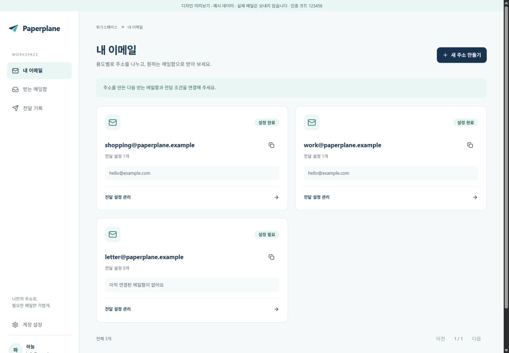

# React 프론트엔드 구현 기록

2026-10-18 기준. 이전 디자인 시안과 API 명세를 실제 React 앱으로 연결한 초기 구현입니다.

## 문서 반영

`ui-ux-plan.md`, `design/pages.md`, `design/interactions.md`, `design/prototype.md`, `design/screen-guide`의 HTML·JSON·이미지와 `api/api-reference.json`을 기준으로 작성했습니다. 네이비/민트, 종이비행기 로고, 내 이메일 중심 흐름, 데스크톱 사이드 메뉴/태블릿 상단 메뉴/모바일 하단 메뉴를 유지합니다. 오래된 인증 시안과 현재 API가 다르면 JSON 명세 및 API 라우트를 우선합니다.

- 주소 상세 단독 API가 없으므로 목록의 page를 URL에 유지하고 그 페이지의 주소를 선택합니다. 해당 페이지에 없으면 목록 복귀를 안내합니다.
- 미인증 목적지나 조회 실패를 설정 완료로 표시하지 않습니다.
- 저장된 중첩 규칙을 그대로 읽고 부분만 바꿉니다. 기존 날짜의 정확한 시각은 유지하고 사용자가 날짜를 바꾼 경우에만 현지 날짜 시작/끝을 UTC로 변환합니다.
- 일반 사용자는 샘플 메일 폼으로 조건을 테스트합니다. 실제 판정은 `/forward/test`에 요청하며 발송하지 않습니다. 조건이 달라진 이전 결과는 재검사를 안내합니다.
- 인증 token은 영구 저장하지 않습니다. 목적지 인증은 오류가 나도 한 번 사용한 challenge를 다시 제출하지 않습니다.
- 계정/목적지/주소 삭제는 영향 범위를 알리고 취소에 기본 초점을 둡니다. 네트워크 실패는 성공 화면으로 바꾸지 않습니다.
- 기존 백엔드 응답 구조·인증 미들웨어·prepared query 스타일을 변경하지 않습니다.

## 확인한 내용

- TypeScript strict 타입 검사, ESLint 검사.
- 자동 테스트 13개 통과: OAuth 콜백 단일 교환/기존 CSRF 유지/만료·provider 불일치 거부, CSRF/refresh 단일 요청 공유, 401 한 번만 재시도, 500 변경 요청 재전송 금지, 로그아웃 후 늦은 refresh 차단, 잘못된 응답 형식 거부, 복합 규칙 보존, 빈 조건/역전 기간 거부, 현지 날짜 경계.
- 브라우저의 개발 전용 예시 데이터 모드에서 주소 중복 오류 및 입력 유지, 새 주소 생성, 인증 화면 왕복 후 초안 보존, 새 목적지 자동 선택, 미저장 이탈 확인/취소, 규칙 저장을 확인했습니다.
- 실제 API 기본 주소 `http://127.0.0.1:8080/health`는 연결 거부였습니다. 따라서 실제 로그인/메일 발송/OAuth/DB 변경의 통합 성공은 아직 검증하지 않았습니다. 실제 API 모드의 연결 실패 UI는 확인했습니다.

## 화면 사진

React 앱을 브라우저에서 촬영한 이미지입니다. 예시 데이터이며 실제 전달 성공 증거가 아닙니다.

데스크톱 1440px, 태블릿 768px, 모바일 390px 및 320px 규칙 편집 화면에서 가로 넘침이 없는 것을 확인했습니다. 화면 전환 시 본문 초점 때문에 상단 메뉴가 스크롤 밖으로 밀리는 문제를 `preventScroll`로 수정했습니다.

| 화면 | 이미지 | 확인 내용 |
| --- | --- | --- |
| 내 이메일 데스크톱 | [사진](screenshots/emails-desktop.png) | 사이드 메뉴, 주소별 상태와 전달 설정 |
| 내 이메일 태블릿 | [사진](screenshots/emails-tablet.png) | 상단 메뉴와 2열 카드 |
| 내 이메일 모바일 | [사진](screenshots/emails-mobile.png) | 1열 카드와 하단 메뉴 |
| 규칙 편집 모바일 | [사진](screenshots/rule-mobile.png) | 날짜·첨부 조건과 저장 버튼 |
| 로그인 데스크톱 | [사진](screenshots/login-desktop.png) | 브랜드 설명과 인증 폼 분리 |
| 로그인 모바일 | [사진](screenshots/login-mobile.png) | 폼 중심 단일 열 배치 |

## 운영 전 확인

API의 DB·Redis·도메인·메일 제공자 설정을 완료하고 실제 API를 실행한 뒤 계정 인증/메일 전달을 확인해야 합니다. 운영 서버의 API reverse proxy, SPA fallback, CORS, HTTPS 쿠키, OAuth callback 주소를 함께 맞추세요. Chromium 기반 브라우저에서 화면을 확인했으며 Safari와 Firefox 실기기 검증은 미완료입니다.
