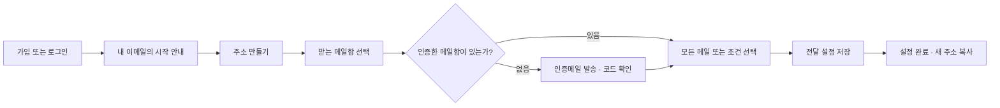

# Paperplane UI/UX 기획

작성일: 2026-10-17. 현재 API 컨트롤러·요청 스키마를 기준으로 한 프런트엔드 설계안이며, 화면 구현이나 운영 서비스 출시를 의미하지 않는다.

후속 상세 설계: [화면 지도·반응형 규격](design/README.md), [전체 페이지 와이어프레임](design/pages.md), [상호작용·상태 명세](design/interactions.md).

## 1. 제품 방향

**“새 이메일 주소로 받고, 원하는 메일함으로 전달하세요.”**

사용자가 달성할 핵심 목표는 주소 하나를 만들고, 인증한 기존 메일함으로 전달하도록 설정하는 것이다. 기본 진입 화면은 ‘내 이메일’이며 통계 대시보드는 만들지 않는다. 종이비행기 로고의 네이비·민트를 활용해 차분하고 읽기 쉬운 도구로 디자인한다.

- 주 대상: 용도별 이메일 주소를 만들고 기존 메일함에서 받아 보고 싶은 개인 사용자.
- 기본 사용: 모든 메일을 한 목적지로 전달. 조건부 전달은 필요할 때 펼친다.
- 프리미엄·결제·요금제·사용량 차트는 범위에서 제외한다.
- 받은편지함, 메일 작성·본문 보기, 실제 발송 테스트, 수동 재시도 버튼을 제공하지 않는다. 현재 API가 제공하지 않는 기능이다.
- SMTP 수신·발송 연동이 확인되기 전에는 ‘전달 중’, ‘정상 작동’ 대신 ‘설정 완료’라고 표시한다.

## 2. 정보 구조와 용어

| 메뉴 | 사용자에게 하는 설명 | 주요 동작 |
| --- | --- | --- |
| 내 이메일 — 기본 홈 | Paperplane에서 사용할 주소 | 주소 만들기·복사, 전달 설정 열기 |
| 받는 메일함 | 전달받을 기존 이메일 주소 | 이메일 인증, 목록 확인, 삭제 |
| 전달 기록 — 보조 메뉴 | 전달 처리 결과 | 기록 조회, 실패 상세 확인 |
| 계정 설정 | 내 프로필과 로그인 정보 | 이름 변경, 로그아웃, 탈퇴 |

‘별칭’, ‘라우팅’, ‘destination’, ‘AND/OR’ 대신 ‘내 이메일’, ‘받는 메일함’, ‘전달 조건’, ‘모두/하나 이상’을 사용한다. API 필드명은 개발 문서에만 노출한다.

데스크톱에서는 왼쪽에 216~232px 탐색 메뉴, 오른쪽에 콘텐츠를 배치한다. 모바일에서는 상단 로고·계정 버튼과 하단 ‘내 이메일 / 받는 메일함 / 전달 기록’ 탐색을 사용한다. 계정 설정은 계정 버튼에서 연다.

## 3. 첫 사용 흐름



상단에는 ‘주소 만들기 → 받는 메일함 → 전달 설정’의 3단계를 보여 준다. 목적지 인증이 필요한 경우 두 번째 단계 안에서 진행한다. 중첩 모달을 열지 않는다.

각 단계는 서버에서 따로 저장된다. 사용자가 중간에 나가더라도 생성한 주소를 삭제하지 않는다. 다시 로그인하면 ‘설정 필요’ 주소에서 이어서 진행할 수 있다. 단, 인증 중 상태와 입력 초안은 서버에 저장되지 않으므로 새로고침 후 영구 복구를 약속하지 않는다.

가입 이메일을 받는 메일함으로 제안할 수는 있지만 자동으로 인증 완료 처리하지 않는다. 소셜 계정은 이메일 값이 없을 수 있으므로 이름과 로그인 제공자만 보여 준다.

## 4. 화면별 상세

### 4.1 소개·로그인·가입

소개 화면은 한 문장 소개, ‘주소 → 조건 → 메일함’ 도식, ‘시작하기’와 ‘로그인’으로 간결하게 구성한다. 실제 사용자 수나 전달률처럼 근거 없는 수치는 넣지 않는다.

로그인 화면은 중앙 400~440px 패널에 Google·Naver 로그인, 이메일 로그인, 비밀번호 찾기를 배치한다. 소셜 버튼은 로고·이름·텍스트를 함께 표시하고 서비스 브랜드색으로 임의 변형하지 않는다.

이메일 가입은 ‘이메일 입력 → 코드 확인 → 이름·비밀번호 입력’ 순서다. 이름 2~8자, 비밀번호 8자 이상·특수문자 포함 조건을 입력 전에 안내한다. 소셜 신규 사용자는 이름만 입력한다. providerId는 입력받지 않는다.

인증번호는 숫자 키패드, 전체 코드 붙여넣기, 자동완성을 지원하는 하나의 입력으로 구현한다. 6개 칸처럼 보이더라도 키보드·스크린리더에서는 단일 필드로 접근할 수 있어야 한다. 입력 완료만으로 자동 제출하지 않는다.

비밀번호 재설정은 이메일 인증 후 새 비밀번호를 입력하며, 성공 후 ‘비밀번호를 변경했어요. 다시 로그인해 주세요.’를 보여 준다.

### 4.2 내 이메일

상단: 제목 ‘내 이메일’, 주소 총 개수, 주 버튼 ‘주소 만들기’.

| 주소 행의 요소 | 동작·표시 규칙 |
| --- | --- |
| 전체 이메일 주소 | 가장 먼저 읽히는 정보. 복사 버튼 제공 |
| 전달 요약 | ‘모든 메일 → me@example.com’ 또는 ‘조건부 전달 · 규칙 2개’ |
| 상태 | 규칙 없음: ‘설정 필요’. 규칙은 있으나 인증 목적지가 없음: ‘메일함 인증 필요’. 유효한 연결이 있음: ‘설정 완료’. 일부 연결이 미인증이면 함께 안내 |
| 주 동작 | ‘전달 설정’ |
| 더보기 | ‘주소 삭제’ |

페이지당 10개를 표시한다. API가 전체 검색을 지원하지 않으므로 첫 버전에는 검색창을 넣지 않는다. 주소별 닉네임·색상·즐겨찾기는 저장 필드가 없으므로 넣지 않는다.

빈 화면: ‘첫 이메일 주소를 만들어 보세요.’ / ‘원하는 메일함으로 전달받을 수 있어요.’ / ‘주소 만들기’.

데스크톱은 얇은 구분선의 목록, 모바일은 한 열의 컴팩트한 카드로 구성한다. 같은 화면에 규칙 편집 폼까지 펼치지 않는다.

### 4.3 주소 만들기

주소 앞부분 입력과 도메인 선택을 한 줄에 배치한다. 도메인이 하나이면 선택 상자 대신 고정 텍스트로 표시한다. 아래에 조합된 주소를 미리 보여 준다.

- 중복 여부는 저장 시 확인한다. 실시간 사용 가능 표시를 만들지 않는다.
- 중복 시 입력을 유지하고 ‘이미 사용 중인 주소예요. 다른 주소를 입력해 주세요.’라고 표시한다.
- 도메인이 없으면 생성을 막고 ‘현재 만들 수 있는 주소가 없어요. 잠시 후 다시 시도해 주세요.’와 새로고침을 제공한다.
- 주소 생성 후 즉시 전달 설정 단계로 이동한다.
- 주소 변경 API가 없으므로 ‘나중에 이름 변경’ 같은 안내를 하지 않는다.

### 4.4 받는 메일함

인증된 이메일 주소와 인증일을 목록으로 표시하고 ‘메일함 추가’를 제공한다. 인증 시작 상태는 현재 추가 폼에서만 관리한다. API 목록은 미인증 항목을 반환하지 않는다.

추가 과정은 ‘이메일 입력 → 코드 발송 → 코드 확인 → 추가 완료’. 서비스 도메인 주소는 허용하지 않는다.

**현재 인증 정책에 맞춘 상태 처리:** 코드 유효시간 10분, 재발송 간격 60초, 확인 시도 1회. 잘못된 코드 또는 만료로 실패하면 같은 토큰으로 재시도시키지 않고 ‘코드를 다시 받아 주세요.’로 전환한다. 한 번 제출하면 중복 제출을 막는다. 제한은 입력 아래에 미리 안내한다.

전달 설정 도중 추가한 경우 인증 성공 시 원래 편집 화면으로 돌아와 새 메일함을 선택하고, 작성 중인 조건을 유지한다. 가입 인증과 목적지 인증은 만료·시도 정책이 다르므로 공통 UI라도 정책값은 분리한다.

### 4.5 전달 설정 — 핵심 화면

제목은 선택한 서비스 주소. 상단에서 주소를 복사할 수 있고 아래에는 기존 전달 규칙 목록과 ‘전달 추가’를 배치한다. 편집은 데스크톱의 넓은 본문, 모바일의 전체 화면에서 진행한다. 확인 대화상자는 삭제·작성 취소에만 사용한다.

기본 편집 폼:

1. **받는 메일함**: 인증된 목적지 중 하나 선택. 바로 아래 ‘다른 메일함 추가’.
2. **어떤 메일을 보낼까요?**: ‘모든 메일’(기본) / ‘조건에 맞는 메일’.
3. **조건 편집**: 조건부 전달에서만 표시.
4. **자연어 요약**: ‘제목에 “영수증”이 포함된 메일을 me@example.com으로 전달합니다.’
5. **조건 테스트**: 샘플 정보를 입력해 판정 확인.
6. **저장 / 취소**.

받는 메일함 하나마다 API 규칙 레코드 하나를 저장한다. 여러 목적지로 보내려면 전달 규칙을 추가한다. 여러 레코드 저장을 하나의 원자적 저장으로 오해할 수 있는 다중 선택 UI는 첫 버전에 넣지 않는다.

**조건 편집:**

| 사용자 표현 | 저장되는 조건 |
| --- | --- |
| 제목 / 보낸 사람 이메일 / 보낸 사람 이름 / 본문 | subject / from / name / content |
| 포함 / 시작 / 끝 | middle / prefix / suffix |
| 모두 일치 / 하나 이상 일치 | and / or |
| 뉴스레터 여부: 구분 안 함 / 뉴스레터만 / 뉴스레터 제외 | all / true / false |
| 날짜: 시작·종료 | date 배열. 입력한 로컬 날짜 범위를 시간대로 변환하여 전송 |
| 첨부파일 이름 / 확장자 | attachment. 파일 내용을 업로드하지 않음 |

첫 표시에는 한 조건 그룹만 보인다. ‘조건 그룹 추가’를 누르면 OR로 연결된 그룹이 생긴다. 그룹 사이에는 항상 ‘또는’을 표시한다. 각 그룹은 동일 필드의 여러 문자열 조건을 내부적으로 묶고, 필드별 모두/하나 이상 옵션을 제공한다. API로 표현할 수 없는 임의 깊이의 중첩식을 만들지 않는다.

날짜 범위 여러 개는 하나 이상 일치, 첨부파일은 하나 이상의 파일이 조건에 일치하면 해당 필드가 참이 되는 현재 엔진 의미를 유지한다. 예를 들어 ‘PDF와 DOCX 모두’가 서로 다른 두 파일의 존재를 뜻하는 것으로 잘못 표시하지 않는다.

조건부 전달에서는 비어 있는 그룹·빈 검색어·비어 있는 첨부파일 조건을 저장하지 못하게 한다. ‘모든 메일’일 때만 빈 규칙 배열을 사용한다. 조건 그룹을 모두 지우면 전체 전달로 자동 전환하지 말고 명시적으로 선택하게 한다.

전달 규칙 이름·우선순위·활성화 스위치는 API에 없으므로 표시하지 않는다. 기존 규칙을 편집할 때는 고급 조건도 손실 없이 불러오고 저장해야 한다.

### 4.6 조건 테스트

규칙 편집 화면 안의 접이식 영역이다. 제목·발신자·본문을 기본 입력으로 제공하고, 적용한 조건에 따라 날짜·뉴스레터·첨부파일 이름 입력을 펼친다. 전송에 필요한 메타데이터는 폼에서 구성하되 존재하지 않는 발신자를 실제 발신자로 오해시키지 않도록 예시값으로 표시한다.

버튼은 ‘조건 확인’. 결과는 ‘전달 조건에 맞아요’ 또는 ‘전달 조건에 맞지 않아요’. 여러 그룹이면 그룹별 일치 결과를 보여 준다. API는 개별 조건별 판정 이유를 반환하지 않으므로 특정 조건을 서버가 검증한 실패 원인처럼 강조하지 않는다.

‘입력한 샘플로 조건만 확인하며, 실제 메일은 보내지 않습니다.’를 결과와 함께 표시한다. 규칙이나 샘플을 수정하면 이전 결과를 지우거나 ‘다시 확인 필요’로 바꾼다. 실제 메일 열람 기능은 연결하지 않는다.

### 4.7 전달 기록

독립된 보조 화면이며 기본 홈의 핵심 요소로 올리지 않는다. 기록은 페이지당 20개, 최신 기록순이다.

| 표시 | 의미 |
| --- | --- |
| 기록 시각 | 서버가 결과를 기록한 시각. 사용자의 로컬 시간대로 표시 |
| 내 이메일 → 받는 메일함 | source → destination |
| 전달 성공 / 전달 실패 / 재시도 기록 | sent / failed / retrying |
| 상세 | 서버가 제공한 detail, 메시지 ID |

각 행은 **메일 한 통의 최종 상태가 아니라 처리 이벤트 하나**다. 같은 messageId의 기록이 여러 개일 수 있다. ‘재시도 기록’을 지금도 재시도 중이라는 실시간 상태로 표현하지 않는다. ‘전달 성공’도 수신자의 열람이나 스팸함 미분류를 보장하지 않는다.

제목·본문·첨부파일은 응답에 없으므로 표시하지 않는다. 검색·기간 필터·실패 필터·메일별 타임라인은 서버 API가 추가되기 전에는 제외한다. 일부 페이지 데이터로 전체 성공률을 계산하지 않는다. 새로고침 버튼을 제공하며 상시 폴링하지 않는다.

빈 화면: ‘아직 전달 기록이 없어요.’ / ‘전달 결과가 기록되면 여기에서 확인할 수 있어요.’ 단순히 기록이 없다는 이유로 SMTP 장애나 미연동으로 단정하지 않는다.

### 4.8 계정 설정과 삭제

이름 변경, 로그인 방식, 확인 가능한 이메일, 로그아웃, 계정 삭제를 배치한다. 로컬 계정에는 비밀번호 재설정 진입을 제공하고 소셜 계정에는 제공자 이름을 표시한다. 이메일 변경·계정 연결·로그인 기기 목록은 제공하지 않는다.

| 삭제 대상 | 확인 대화상자의 설명 |
| --- | --- |
| 내 이메일 | ‘이 주소의 전달 규칙과 전달 기록도 삭제됩니다.’ |
| 받는 메일함 | ‘이 메일함으로 연결된 전달 규칙도 삭제됩니다.’ |
| 계정 | ‘내 이메일, 받는 메일함, 전달 규칙과 기록이 모두 삭제됩니다.’ |

확인 버튼은 ‘삭제’보다 ‘주소 삭제’, ‘메일함 삭제’, ‘계정 삭제’처럼 대상을 명시한다. 취소를 기본 선택으로 두며 계정 삭제에는 확인 체크를 받는다. 복원 API가 없으므로 ‘실행 취소’ 알림은 제공하지 않는다. 삭제 영향 수량을 전체 조회 없이 추정해서 표시하지 않는다.

## 5. 화면 구성 초안

데스크톱 ‘내 이메일’:

```text
┌──────────────────┬───────────────────────────────────────────┐
│ ✈ Paperplane     │ 내 이메일                       [주소 만들기] │
│                  │ 새 주소로 받고, 원하는 메일함으로 전달하세요. │
│ 내 이메일        │                                           │
│ 받는 메일함      │ shop@서비스도메인                 [복사]    │
│ 전달 기록        │ 모든 메일 → me@example.com       [전달 설정] │
│                  │ ───────────────────────────────────────── │
│                  │ work@서비스도메인                 [복사]    │
│                  │ 설정 필요                        [설정하기] │
│                  │                                           │
│ 계정 설정        │                     [이전]  1 / 2  [다음] │
└──────────────────┴───────────────────────────────────────────┘
```

모바일 전달 편집:

```text
← 전달 설정
shop@서비스도메인                         복사

받는 메일함
[ me@example.com                         ▾ ]
다른 메일함 추가

어떤 메일을 보낼까요?
( ) 모든 메일   (●) 조건에 맞는 메일

다음 조건이 [모두 일치 ▾]하면
[제목 ▾] [포함 ▾]
[영수증                                   ]
+ 조건 추가

제목에 ‘영수증’이 포함된 메일을 전달합니다.
▸ 샘플로 조건 확인

[취소]                         [설정 저장]
```

## 6. 시각 디자인

| 요소 | 제안 |
| --- | --- |
| 로고 | `public/icon.png`를 헤더 28~32px로 사용. 탭에는 `favicon.ico` |
| 배경 | #F7FAFA, 콘텐츠 표면은 #FFFFFF |
| 본문·주 버튼 | 네이비 #17324D. 주 버튼은 네이비 배경+흰 글자 |
| 브랜드 강조 | 민트 #4DB6AC, 연한 배경 #E9F6F3. 민트를 흰 배경의 작은 본문색으로 사용하지 않음 |
| 보조 글자·테두리 | #526571 / #DCE6E8 |
| 성공·주의·오류 | 짙은 녹색·황갈색·빨강을 텍스트 및 아이콘과 함께 사용. 색만으로 구별하지 않음 |
| 글꼴 | 외부 폰트 요청 없이 시스템 한글 고딕을 기본 사용. 제목 24~28px, 본문 16px, 보조 14px |
| 간격·모양 | 4px 단위, 섹션 간격 24~32px, 입력 높이 44~48px, 모서리 10~12px |
| 장식 | 충분한 여백, 얇은 경계선, 제한적인 그림자. 비행기 모션·배경 패턴은 기능 화면에서 사용하지 않음 |

본문 최대 폭 약 1120px, 편집 폼은 720px 안팎. 768px 미만은 한 열, 768~1023px는 상단 탐색, 1024px 이상은 사이드바를 사용한다. 모바일 편집 페이지에서는 하단 전역 탐색 대신 저장 버튼 영역을 두고, 키보드·안전 영역에 가려지지 않게 한다.

## 7. 공통 인터랙션과 오류

- 로딩: 목록은 스켈레톤, 제출은 해당 버튼의 진행 상태. 기존 목록을 통째로 지우지 않는다.
- 저장: 성공 응답을 받은 후에만 완료로 표시하고 관련 목록을 갱신한다. 실패 시 입력을 유지한다.
- 네트워크 단절: ‘연결을 확인한 뒤 다시 시도해 주세요.’ 삭제·생성 요청 결과가 불명확하면 자동 재전송하지 않고 목록을 확인한다.
- 인증 만료: 동시 요청은 한 번의 토큰 갱신을 공유한다. 실패 시 로그인 안내와 돌아갈 경로를 보존한다. 서버가 갱신마다 기존 Access Token을 폐기하므로 무제한 재시도를 금지한다.
- 403/401: ‘로그인이 필요해요’와 재로그인. 원시 JWT·CSRF 오류를 사용자에게 보여 주지 않는다.
- 404: 다른 화면에서 삭제된 항목일 수 있으므로 목록으로 돌아가 갱신한다.
- 409: 주소 중복 등 해당 입력 옆에서 설명한다.
- 429: 서버의 Retry-After 또는 TTL을 우선 사용한다. 목적지 인증처럼 값을 주지 않는 경우 보수적인 60초 안내를 사용하되 서버 판정을 최종 기준으로 한다.
- 502/503: 발송·서비스 오류를 구분하고 재시도 동작을 제공한다. 발송 실패를 이메일 소유권 문제로 표시하지 않는다.
- 복사: 성공 알림을 짧게 표시하고 클립보드 실패 시 주소 선택·수동 복사를 안내한다.
- 미저장 변경: 화면 이동 시 확인. 저장하지 않은 규칙을 조용히 버리지 않는다.
- 접근성: 모든 필드에 레이블, 명확한 포커스, 키보드 조작, 결과 알림의 live region, 최소 44px 터치 영역. 모달 포커스 복귀와 동작 감소 설정을 지원한다. 긴 주소는 줄바꿈하고 전체 값을 접근 가능하게 유지한다.

## 8. 화면과 API 연결

공통 접두사 `/api/v1`. 내부 `/router`, `/internal/deliveries`는 브라우저에서 호출하지 않는다.

| 화면 | 사용 API |
| --- | --- |
| 로그인·가입·복구 | `/auth/csrf`, `/auth/login`, `/auth/register`, `/verify/email`, `/verify/code`, `/verify/oauth`, `/verify/provider`, `/auth/password/reset` |
| 세션 복구·종료 | `/auth/refresh`, `/auth/logout`, `GET /users/me` |
| 주소 목록·생성 | `GET /domains`, `GET/POST/DELETE /email` |
| 메일함 관리 | `GET/DELETE /destinations`, `POST /destinations/verify`, `POST /destinations/confirm` |
| 전달 설정 | `GET /email`에서 규칙 확보, `POST/PATCH/DELETE /forward`, `POST /forward/test` |
| 전달 기록 | `GET /deliveries` |
| 계정 설정 | `GET/PATCH/DELETE /users/me` |

브라우저에서 전체 도메인을 관리하거나 내부 상태 점검 결과를 일반 사용자 화면에 노출하지 않는다.

## 9. 현재 API로 가능한 범위와 후속 보완

| 항목 | 첫 버전 설계 | 개선이 필요할 때 |
| --- | --- | --- |
| 주소 상세 직접 링크 | 목록의 페이지와 선택 ID를 함께 유지하고 해당 페이지 응답에서 선택. 항목이 없으면 목록으로 복귀 | `GET /email/:id`로 안정적인 딥링크 지원 |
| 검색·기록 필터 | 페이지 이동만 제공 | 서버 검색·기간·상태 필터 추가 |
| 목적지 삭제 영향 개수 | 규칙이 함께 삭제된다는 사실만 안내 | 연결 규칙 수·목록 조회 추가 |
| 목적지 코드 오입력 | 새 인증 요청으로 안내 | 서버가 제한 횟수 내 재시도를 지원하면 마찰 감소 |
| 실제 전달 상태 | 설정 완료와 결과 기록만 표시 | SMTP 수신·발송 연동 확인 후 기능 출시 |
| 일시정지 | 제공하지 않음 | 서버에 enabled 필드 및 실제 판정 반영 필요 |
| 이름·설명으로 주소 구분 | 주소 자체로 표시 | 주소·규칙 표시 이름 필드가 필요 |

후속 보완 항목은 이번 기획에서 새로 구현한 API가 아니다. 프런트엔드가 현재 API에 없는 상태를 임의로 저장해서 기능처럼 보이게 하지 않는다.

## 10. 제작 순서와 완료 기준

| 단계 | 제작 범위 | 확인할 결과 |
| --- | --- | --- |
| 1 | 공통 레이아웃, 로그인·가입·인증 | 로그인 후 내 이메일 진입, 인증 오류·만료에서 복구 가능 |
| 2 | 내 이메일, 주소 생성, 받는 메일함 인증, 전체 전달 설정 | 신규 사용자가 첫 주소와 전달 설정을 끝낼 수 있음 |
| 3 | 조건 편집·샘플 테스트 | 저장된 복합 규칙을 손실 없이 다시 편집 가능 |
| 4 | 전달 기록, 계정 설정, 삭제 흐름 | 내 기록만 표시, 삭제 영향 안내와 실제 결과 일치 |
| 5 | 모바일·접근성·통합 검증 | 360px 화면에서 가로 스크롤 없이 핵심 흐름 완료, 키보드만으로도 인증·설정 완료 |

대표 검증 시나리오: 신규 이메일 가입, Google/Naver 신규·기존 회원, 인증코드 실패·재발송, 주소 중복, 중단한 설정 이어하기, 인증 목적지 추가 후 편집 복귀, 조건 테스트 후 수정, 다른 탭에서 항목 삭제, 세션 만료, 기록 없음·실패 기록, 계정 탈퇴.

사용성 검토에서는 ‘이 주소로 받은 메일이 어디로 가는지 설명할 수 있는가’, ‘첫 설정 중 어디에서 멈추는가’, ‘조건 요약이 실제 판정과 일치하는가’를 확인한다. 측정을 위한 분석 SDK나 추적 기능은 이 기획만으로 설치하지 않는다.
